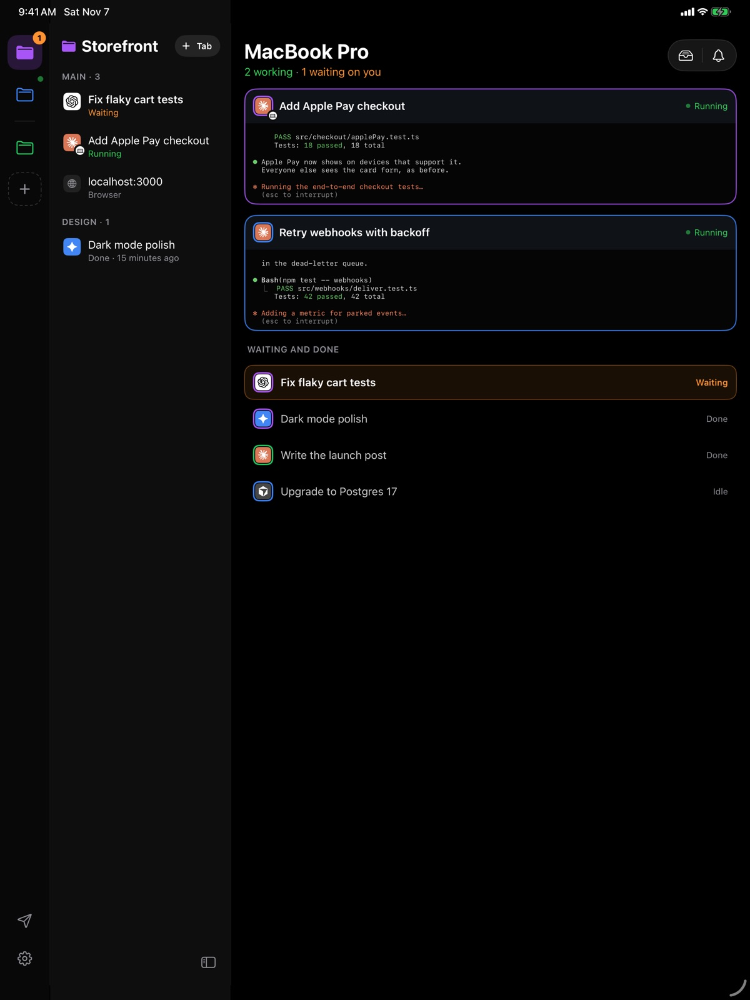
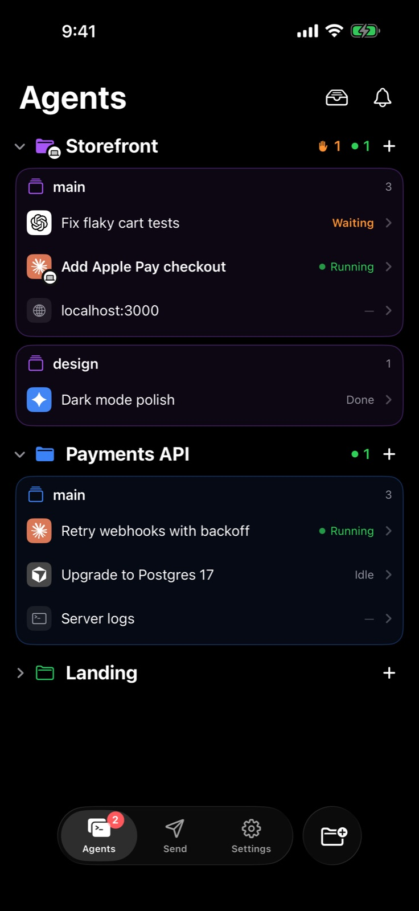

**Dax Companion** is the mobile app for Dax. Start a task at your desk, walk
away, and keep it moving from your iPhone or iPad: every agent on your Mac,
what it's doing, what it finished, and what it's waiting on you for.

<Card title="Download on the App Store" icon="apple" href="https://apps.apple.com/app/dax-companion/id6828041761" horizontal>
  Free for iPhone and iPad. Needs Dax on your Mac.
</Card>

<Frame>
  
</Frame>

## Pair it with your Mac

<Steps>
  <Step title="Install the app">
    Get [Dax Companion from the App Store](https://apps.apple.com/app/dax-companion/id6828041761)
    on your iPhone or iPad.
  </Step>
  <Step title="Show the code on your Mac">
    In Dax, click the phone at the bottom of the sidebar, then **Add a device**.
    A QR code appears.
  </Step>
  <Step title="Scan it">
    Open Dax Companion and scan the code. That's it: no account to create on
    the phone. Pair as many iPhones and iPads as you like.
  </Step>
</Steps>

## What you can do

<CardGroup cols={2}>
  <Card title="See every agent" icon="layer-group">
    Every agent in every project, running, waiting, idle or done, live as it
    changes. Claude Code, Codex, Gemini CLI, Cursor and other terminal agents.
  </Card>
  <Card title="Steer from anywhere" icon="terminal">
    Watch an agent's terminal as it works, and type its next prompt or answer
    its question. It goes straight to the agent on your Mac.
  </Card>
  <Card title="Never miss a question" icon="bell">
    A notification the moment an agent finishes or needs you; answer with one
    tap. On iPhone, follow a task on the Lock Screen and in the Dynamic Island.
  </Card>
  <Card title="Send to your Mac" icon="paper-plane">
    Photos, videos, files and links to your Mac's File Drawer, its clipboard,
    or straight to an agent, from the app or the share sheet.
  </Card>
  <Card title="Your Mac, in hand" icon="laptop">
    Battery, volume, brightness and media controls. Lock it, keep it awake, or
    glance at its screen when you turn screen sharing on.
  </Card>
  <Card title="AI Video clips" icon="film">
    Clips you make with Dax's AI Video arrive on your iPhone and iPad by
    themselves, ready to save to Photos.
  </Card>
</CardGroup>

## On iPad

The iPad has a layout of its own: your projects in a rail, their agents beside
them, and the terminal on the right. With nothing open, every running agent
shows as a live terminal card, so you can watch the whole herd at once. Turn
it on its side and the Mac page puts your Mac's screen and its controls side
by side.

<Frame>
  
</Frame>

## Unpairing

On the phone, **Settings › Unpair this iPhone** (or iPad). On the Mac, click
the phone at the bottom of the sidebar and choose **Disconnect** for the device. Either one cuts
it off at once.
