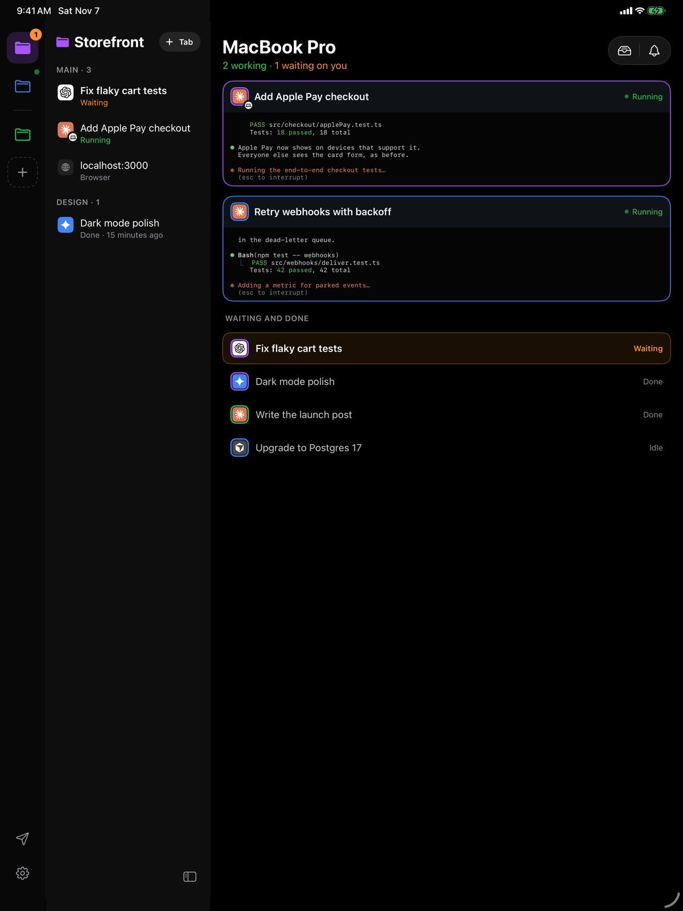
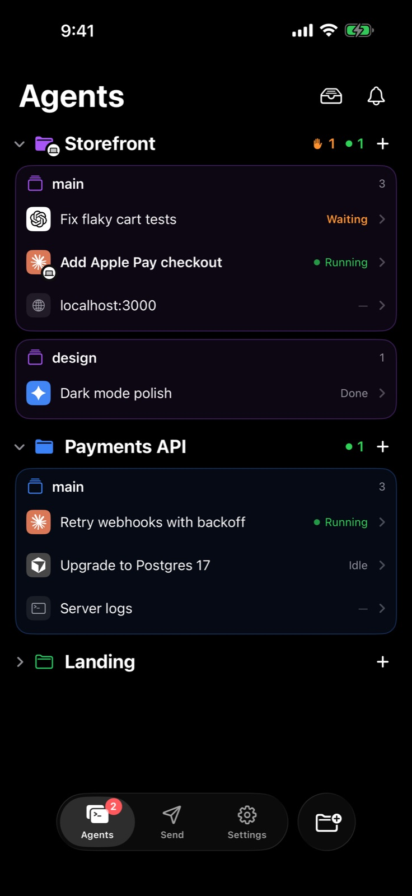

**Dax Companion** es la app móvil de Dax. Empieza una tarea en tu escritorio,
aléjate y mantenla en marcha desde tu iPhone o iPad: cada agente de tu Mac, lo
que está haciendo, lo que ha terminado y lo que espera de ti.

<Card title="Descargar en la App Store" icon="apple" href="https://apps.apple.com/app/dax-companion/id6828041761" horizontal>
  Gratis, para iPhone y iPad. Necesita Dax en tu Mac.
</Card>

<Frame>
  
</Frame>

## Vincúlala con tu Mac

<Steps>
  <Step title="Instala la app">
    Consigue [Dax Companion en la App Store](https://apps.apple.com/app/dax-companion/id6828041761)
    en tu iPhone o iPad.
  </Step>
  <Step title="Muestra el código en tu Mac">
    En Dax, haz clic en el teléfono de la parte inferior de la barra lateral y
    luego en **Add a device**. Aparecerá un código QR.
  </Step>
  <Step title="Escanéalo">
    Abre Dax Companion y escanea el código. Eso es todo: no hay que crear
    ninguna cuenta en el teléfono. Vincula tantos iPhone y iPad como quieras.
  </Step>
</Steps>

## Qué puedes hacer

<CardGroup cols={2}>
  <Card title="Ver cada agente" icon="layer-group">
    Todos los agentes de todos los proyectos, en ejecución, en espera, inactivos
    o terminados, en vivo según cambian. Claude Code, Codex, Gemini CLI, Cursor
    y otros agentes de terminal.
  </Card>
  <Card title="Dirige desde donde estés" icon="terminal">
    Mira la terminal de un agente mientras trabaja, escribe su siguiente prompt
    o responde a su pregunta. Llega directamente al agente de tu Mac.
  </Card>
  <Card title="No te pierdas ninguna pregunta" icon="bell">
    Una notificación en cuanto un agente termina o te necesita; responde con un
    toque. En iPhone, sigue una tarea en la pantalla de bloqueo y en la Dynamic
    Island.
  </Card>
  <Card title="Envía a tu Mac" icon="paper-plane">
    Fotos, vídeos, archivos y enlaces al Shelf de tu Mac, a su
    portapapeles o directamente a un agente, desde la app o desde el menú
    compartir.
  </Card>
  <Card title="Tu Mac, en la mano" icon="laptop">
    Batería, volumen, brillo y controles multimedia. Bloquéalo, mantenlo activo
    o echa un vistazo a su pantalla cuando actives la pantalla compartida.
  </Card>
  <Card title="Clips de AI Video" icon="film">
    Los clips que creas con AI Video de Dax llegan solos a tu iPhone y iPad,
    listos para guardar en Fotos.
  </Card>
</CardGroup>

## En iPad

El iPad tiene un diseño propio: tus proyectos en una barra lateral, sus agentes
a su lado y la terminal a la derecha. Con nada abierto, cada agente en ejecución
aparece como una tarjeta de terminal en vivo, así que puedes ver a todos tus
agentes a la vez. Gíralo de lado y la página Mac muestra la pantalla de tu Mac y
sus controles uno junto al otro.

<Frame>
  
</Frame>

## Desvincular

En el teléfono, **Settings › Unpair this iPhone** (o iPad). En el Mac, haz clic
en el teléfono de la parte inferior de la barra lateral y elige **Disconnect**
para el dispositivo. Cualquiera de las dos formas lo corta al instante.
