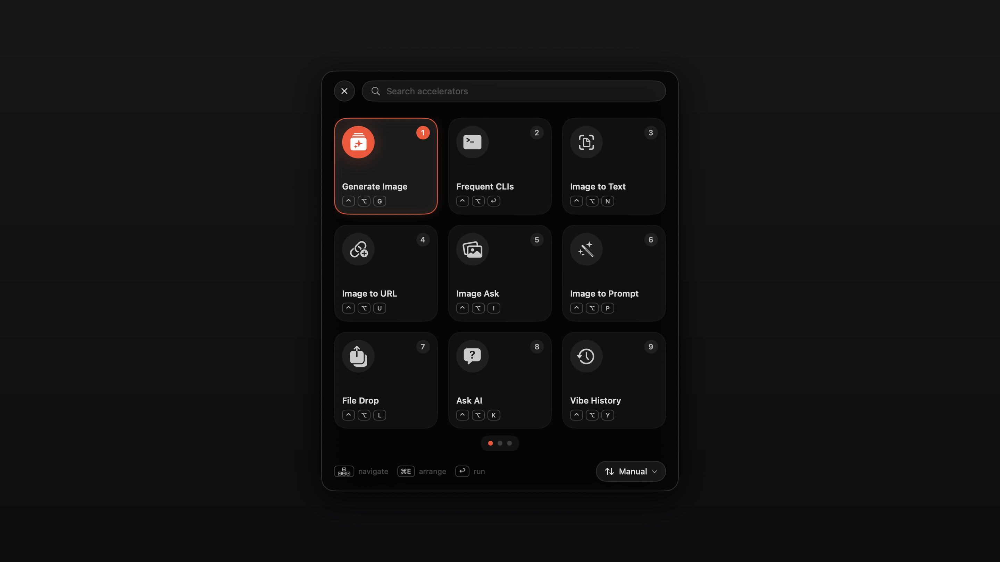

Dax es una sola plataforma. La **ventana principal** es donde se ejecutan tus
agentes de código. Los **Accelerators** son las partes de Dax que invocas
desde cualquier app. **Dax Companion** lo lleva todo a tu iPhone y iPad. Hay
algunas cosas que son ciertas en todo Dax, así que las explicamos una sola vez
aquí.

## Invocar Accelerators

- **Cada Accelerator tiene un atajo global.** Por defecto todos son
  <kbd>⌃</kbd> <kbd>⌥</kbd> más una tecla. Reasigna o borra cualquier atajo
  en **Settings → Shortcuts** (<kbd>⌃</kbd> <kbd>⌥</kbd> <kbd>H</kbd>);
  consulta la [referencia rápida](/es/shortcuts) para ver la lista completa.
- **El lanzador de Accelerators:** pulsa <kbd>⌃</kbd> <kbd>⌥</kbd>
  <kbd>Space</kbd> para abrir una cuadrícula con todos los Accelerators.
  Haz clic en uno, o pulsa <kbd>1</kbd>–<kbd>9</kbd> para los nueve
  primeros. Útil mientras aún no te sabes un atajo de memoria.
- **El icono de la barra de menú** también los lista y abre Settings.

<Frame>
  
</Frame>

### Atajos de Dax

| Atajo | Abre |
| --- | --- |
| <kbd>⌃</kbd> <kbd>⌥</kbd> <kbd>Space</kbd> | El lanzador de Accelerators |
| <kbd>⌃</kbd> <kbd>⌥</kbd> <kbd>,</kbd> | Settings |
| <kbd>⌃</kbd> <kbd>⌥</kbd> <kbd>T</kbd> | Settings → Accelerators |
| <kbd>⌃</kbd> <kbd>⌥</kbd> <kbd>H</kbd> | Settings → Shortcuts (reasignar atajos) |

## Primeros pasos

Cuando abres Dax por primera vez, una pantalla de configuración te guía
para crear una cuenta:

- **Regístrate** con tu nombre y correo electrónico. Te enviaremos un
  código; escríbelo y tu cuenta se activa al instante. Empieza en el plan
  **Free** y sube a **Pro** ($10/mes, 2,500 credits) vía Stripe en
  cualquier momento.

¿Ya tienes un código? Hay un enlace **Already have a code?** en la
pantalla de configuración para ingresarlo directamente.

Una vez activado, tu token de acceso personal se guarda en el Keychain de
tu Mac y todo Dax se desbloquea.

### Planes (cuentas gestionadas)

Todos los planes incluyen todo Dax. Solo la IA usa créditos.

| | Free | Pro ($10/mes) |
| --- | --- | --- |
| Créditos de IA | Una imagen gratis, una vez | 2,500 al mes |
| Ask AI | Con una recarga | Incluido, con Deep Research y Web Search |
| AI Video | — | Incluido |
| Subida de archivos | 32 MB por archivo | 10 GB |
| Agentes, servidores SSH, Accelerators | Incluido | Incluido |

El regalo de Free alcanza para una imagen generada y no se renueva. Para
usar Ask AI en Free, compra una recarga.

#### Coste por créditos

| Acción | Créditos |
| --- | --- |
| Ask AI | 1 |
| Reescribir texto | 1 |
| Web Search (Ask AI) | 2 |
| Preguntar sobre una imagen | 2 |
| Rellenar un formulario con contexto | 2 |
| AI prompt | 2 |
| Escribir una especificación | 5 |
| Generate Image | 25 |
| Deep Research | 25 |
| AI Video | Por clip, según modelo y duración |

Los créditos de Pro se reinician el 1 de cada mes.

#### Recargar créditos

¿Necesitas más créditos? Compra una recarga en Dax cuando quieras. Los
créditos se añaden al instante. En Pro duran hasta fin de mes; en Free se
quedan hasta que los uses.

| Precio | Créditos |
| --- | --- |
| $10 | 2,500 |
| $20 | 5,200 |
| $50 | 13,500 |
| $100 | 28,000 |
| $250 | 72,500 |

Orden de gasto: primero los créditos del plan, después los de recarga.

Sube de plan en cualquier momento desde la ventana **Usage**. Gestiona o
cancela tu suscripción a través del portal de clientes de Stripe.

Si tu cuenta está suspendida, Dax entra en un estado bloqueado y cada
Accelerator te dirige amablemente al soporte en lugar de abrirse.

## Accelerators en línea y sin conexión

Algunos Accelerators son completamente locales; otros necesitan internet.
**Sin conexión, los Accelerators que necesitan red se atenúan en el
lanzador** y muestran un aviso de "necesita internet" en lugar de abrir un
panel condenado a fallar. Se reactivan en cuanto vuelve la conexión.

<CardGroup cols={2}>
  <Card title="Funcionan sin conexión" icon="wifi-slash">
    [Ventana principal](/es/main-window), [Frequent CLIs](/es/accelerators/frequent-clis), [Inject MD or Skill](/es/accelerators/inject-md) (excepto Share as a Link), [Vibe History](/es/accelerators/vibe-history), [Image to Text](/es/accelerators/image-to-text), [Secrets](/es/accelerators/secrets), [Remove BG](/es/accelerators/remove-bg), [Prompt Snippets](/es/accelerators/prompt-snippets), [Markdown Viewer](/es/accelerators/markdown-viewer), [Shelf](/es/accelerators/shelf), [Schedules](/es/accelerators/schedules)
  </Card>
  <Card title="Necesitan conexión" icon="wifi">
    [Ask AI](/es/accelerators/ask-ai), [AI Text Transform](/es/accelerators/text-transform), [Image to Prompt](/es/accelerators/image-to-prompt), [Image Ask](/es/accelerators/image-ask), [Generate Image](/es/accelerators/generate-image), [Context Form Fill](/es/accelerators/context-fill), [Image to URL](/es/accelerators/image-to-url), [File Drop](/es/accelerators/file-drop), [Clip to Link](/es/accelerators/clip-to-link), [Screen Markup](/es/accelerators/screen-markup), [Feedback](/es/accelerators/feedback)
  </Card>
</CardGroup>

## Notificaciones

Dax se comunica a través de notificaciones toast discretas: pequeñas tarjetas flotantes que aparecen y se cierran solas.

## Privacidad

Los Accelerators locales nunca tocan la red. Los Accelerators en línea envían
**solo** lo que necesitan, y **solo** cuando pulsas el atajo o haces clic en un
botón, nunca porque hayas copiado algo. Los detalles están en la página de
cada Accelerator y en la política de privacidad.
