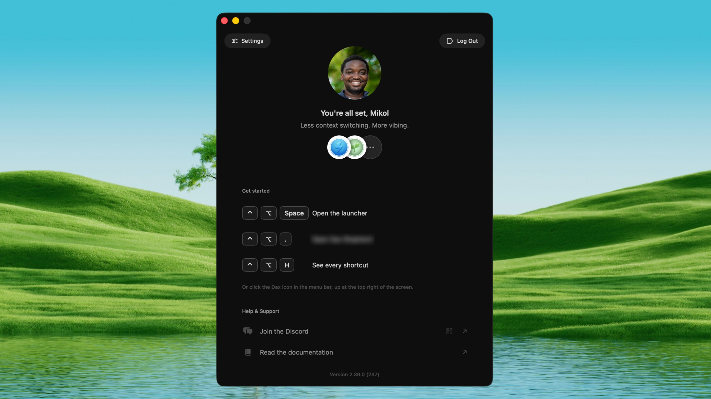

<Frame>
  
</Frame>

**The human harness for working with AI agents.** Agents have harnesses. Now you do too.

Dax es una sola plataforma para trabajar con agentes de código de IA. Ejecuta
tus agentes uno al lado del otro en la **ventana principal**, recurre a un
**Accelerator** desde cualquier app cuando lo necesites y sigue todo desde tu
teléfono con **Dax Companion**.

<CardGroup cols={3}>
  <Card title="Ventana principal" icon="grid-2-plus" href="/es/main-window">
    Tus agentes de código uno al lado del otro, en tu Mac o en un servidor por SSH.
  </Card>
  <Card title="Accelerators" icon="bolt" href="/es/accelerators/overview">
    Integrados en Dax, a un atajo de distancia desde cualquier app.
  </Card>
  <Card title="Dax Companion" icon="mobile" href="/es/companion">
    La app móvil de Dax: tus agentes de código en iPhone y iPad.
  </Card>
</CardGroup>

## Empieza aquí

<CardGroup cols={2}>
  <Card title="Guía rápida" icon="rocket" href="/es/quickstart">
    Instala Dax y abre tu primer Accelerator en menos de dos minutos.
  </Card>
  <Card title="Cómo funciona Dax" icon="circle-info" href="/es/how-dax-works">
    Tu cuenta, planes y créditos, comportamiento sin conexión y privacidad.
  </Card>
  <Card title="Atajos de teclado" icon="keyboard" href="/es/shortcuts">
    Todos los atajos de Dax en una sola tabla.
  </Card>
  <Card title="Crea el tuyo" icon="code" href="/developers/accelerator-sdk">
    Escribe un Accelerator personalizado con el Accelerator SDK.
  </Card>
</CardGroup>

## Accelerators

Los Accelerators son las partes de Dax que invocas desde cualquier lugar:
pulsa <kbd>⌃</kbd> <kbd>⌥</kbd> <kbd>Space</kbd> para abrir el lanzador, o el
atajo propio de cada uno.

### Captura y comparte

<CardGroup cols={3}>
  <Card title="Image to URL" icon="link" href="/es/accelerators/image-to-url">
    Suelta una imagen, obtén un enlace alojado.
  </Card>
  <Card title="File Drop" icon="files" href="/es/accelerators/file-drop">
    Sube archivos en lote de una sola vez.
  </Card>
  <Card title="Clip to Link" icon="video" href="/es/accelerators/clip-to-link">
    Graba una región, obtén un enlace.
  </Card>
  <Card title="Shelf" icon="inbox" href="/es/accelerators/shelf">
    Ten archivos a mano en el borde de tu pantalla.
  </Card>
  <Card title="Screen Markup" icon="pen" href="/es/accelerators/screen-markup">
    Dibuja sobre tu pantalla y comparte la captura.
  </Card>
</CardGroup>

### IA

<CardGroup cols={3}>
  <Card title="Ask AI" icon="comment-dots" href="/es/accelerators/ask-ai">
    Haz una pregunta rápida, desde cualquier lugar.
  </Card>
  <Card title="Image Ask" icon="comments" href="/es/accelerators/image-ask">
    Pregúntale a la IA sobre una imagen.
  </Card>
  <Card title="Generate Image" icon="image" href="/es/accelerators/generate-image">
    Crea una imagen a partir de un prompt.
  </Card>
  <Card title="Image to Prompt" icon="wand-magic-sparkles" href="/es/accelerators/image-to-prompt">
    Convierte cualquier imagen en un prompt.
  </Card>
  <Card title="AI Text Transform" icon="pen-nib" href="/es/accelerators/text-transform">
    Reescribe o transforma el texto seleccionado.
  </Card>
  <Card title="Context Form Fill" icon="file-lines" href="/es/accelerators/context-fill">
    Rellena formularios automáticamente usando tu contexto guardado.
  </Card>
  <Card title="Image to Text" icon="scanner" href="/es/accelerators/image-to-text">
    Extrae texto de cualquier imagen con OCR en dispositivo.
  </Card>
</CardGroup>

### Flujo de trabajo con agentes

<CardGroup cols={3}>
  <Card title="Frequent CLIs" icon="terminal" href="/es/accelerators/frequent-clis">
    Accede directo a las CLI que más usas.
  </Card>
  <Card title="Inject MD or Skill" icon="markdown" href="/es/accelerators/inject-md">
    Añade un AGENTS.md o instala una habilidad en cualquier proyecto.
  </Card>
  <Card title="Prompt Snippets" icon="note-sticky" href="/es/accelerators/prompt-snippets">
    Prompts guardados que puedes buscar y pegar.
  </Card>
  <Card title="Vibe History" icon="clock-rotate-left" href="/es/accelerators/vibe-history">
    Retoma una sesión de código o copia su contexto a una nueva.
  </Card>
  <Card title="Secrets" icon="key" href="/es/accelerators/secrets">
    Bóveda cifrada de claves y valores en tu barra de menú.
  </Card>
  <Card title="Schedules" icon="calendar-clock" href="/es/accelerators/schedules">
    Pon a un agente a trabajar en una tarea más tarde, o de forma periódica.
  </Card>
  <Card title="Markdown Viewer" icon="file-text" href="/es/accelerators/markdown-viewer">
    Abre, lee y edita Markdown con renderizado en vivo.
  </Card>
  <Card title="Remove BG" icon="scissors" href="/es/accelerators/remove-bg">
    Recorta el sujeto de una imagen.
  </Card>
  <Card title="Feedback" icon="message-heart" href="/es/accelerators/feedback">
    Envía una nota y recortes de pantalla al equipo.
  </Card>
</CardGroup>
