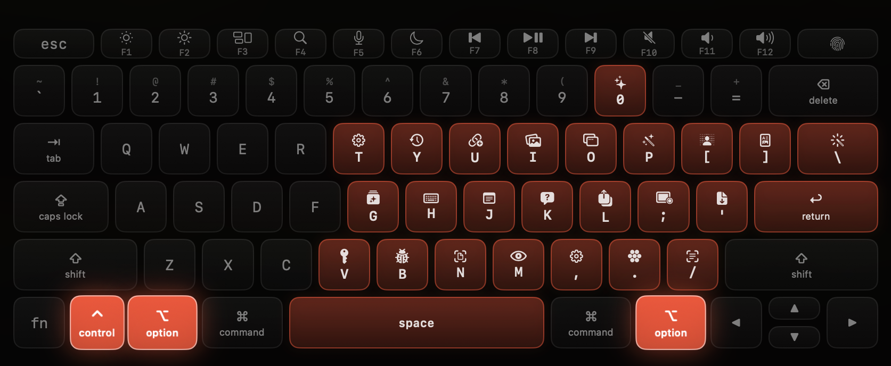

Cada Accelerator tiene su propio atajo global, y Dax tiene algunos más para
sí mismo (el lanzador, Settings, el Shelf). Todos los atajos de abajo son los
valores por defecto. Reasigna o borra el atajo de cualquier Accelerator en
**Settings → Shortcuts** (<kbd>⌃</kbd> <kbd>⌥</kbd> <kbd>H</kbd>), así que los
tuyos pueden ser distintos.

<Frame>
  
</Frame>

<Note>
  ¿Nuevo en Dax? [Cómo funciona Dax](/es/how-dax-works) cubre tu cuenta, el
  lanzador y el comportamiento sin conexión.
</Note>

## Accelerators

| Accelerator | Atajo | Internet | Resumen |
| --- | --- | :---: | --- |
| [Ventana principal](/es/main-window) | <kbd>⌃</kbd> <kbd>⌥</kbd> <kbd>.</kbd> | - | Tus agentes de código uno al lado del otro, en local o en un servidor |
| [Frequent CLIs](/es/accelerators/frequent-clis) | <kbd>⌃</kbd> <kbd>⌥</kbd> <kbd>Return</kbd> | - | Escribe tus comandos habituales en la app enfocada |
| [Image to URL](/es/accelerators/image-to-url) | <kbd>⌃</kbd> <kbd>⌥</kbd> <kbd>U</kbd> | ✓ | Convierte una imagen copiada en un enlace compartible |
| [Image Ask](/es/accelerators/image-ask) | <kbd>⌃</kbd> <kbd>⌥</kbd> <kbd>I</kbd> | ✓ | Pregunta sobre una región de la pantalla |
| [Image to Prompt](/es/accelerators/image-to-prompt) | <kbd>⌃</kbd> <kbd>⌥</kbd> <kbd>P</kbd> | ✓ | Convierte una imagen en un prompt de generación |
| [Generate Image](/es/accelerators/generate-image) | <kbd>⌃</kbd> <kbd>⌥</kbd> <kbd>G</kbd> | ✓ | Crea o edita una imagen a partir de un prompt |
| [AI Text Transform](/es/accelerators/text-transform) | <kbd>⌃</kbd> <kbd>⌥</kbd> <kbd>\\</kbd> | ✓ | Reescribe el texto seleccionado en el lugar |
| [File Drop](/es/accelerators/file-drop) | <kbd>⌃</kbd> <kbd>⌥</kbd> <kbd>L</kbd> | ✓ | Suelta archivos o carpetas, obtén un enlace compartible |
| [Ask AI](/es/accelerators/ask-ai) | <kbd>⌃</kbd> <kbd>⌥</kbd> <kbd>K</kbd> | ✓ | Un cuadro de preguntas flotante para dudas rápidas |
| [Vibe History](/es/accelerators/vibe-history) | <kbd>⌃</kbd> <kbd>⌥</kbd> <kbd>Y</kbd> | - | Retoma una conversación reciente de Claude Code / Codex |
| [Inject MD or Skill](/es/accelerators/inject-md) | <kbd>⌃</kbd> <kbd>⌥</kbd> <kbd>'</kbd> | ◐ | Añade un AGENTS.md, instala una habilidad o comparte un archivo como enlace |
| [Secrets](/es/accelerators/secrets) | <kbd>⌃</kbd> <kbd>⌥</kbd> <kbd>V</kbd> | - | Entrega secretos a agentes de código sin pegarlos |
| [Context Form Fill](/es/accelerators/context-fill) | <kbd>⌃</kbd> <kbd>⌥</kbd> <kbd>/</kbd> | ✓ | Recorta una pregunta de formulario, obtén una respuesta lista para pegar |
| [Image to Text](/es/accelerators/image-to-text) | <kbd>⌃</kbd> <kbd>⌥</kbd> <kbd>N</kbd> | - | Extrae texto de una captura de pantalla o imagen |
| [Remove BG](/es/accelerators/remove-bg) | <kbd>⌃</kbd> <kbd>⌥</kbd> <kbd>[</kbd> | - | Recorta el sujeto de una imagen, en dispositivo |
| [Clip to Link](/es/accelerators/clip-to-link) | <kbd>⌃</kbd> <kbd>⌥</kbd> <kbd>;</kbd> | ✓ | Graba una región, obtén un enlace GIF/MP4/MOV |
| [Prompt Snippets](/es/accelerators/prompt-snippets) | <kbd>⌃</kbd> <kbd>⌥</kbd> <kbd>J</kbd> | - | Prompts guardados que puedes buscar y pegar |
| [Markdown Viewer](/es/accelerators/markdown-viewer) | <kbd>⌃</kbd> <kbd>⌥</kbd> <kbd>]</kbd> | - | Abre, lee y edita archivos Markdown con renderizado en vivo |
| [Shelf](/es/accelerators/shelf) | <kbd>⌃</kbd> <kbd>⌥</kbd> <kbd>D</kbd> | - | Ten archivos a mano en el borde de tu pantalla |
| [Screen Markup](/es/accelerators/screen-markup) | <kbd>⌃</kbd> <kbd>⌥</kbd> <kbd>M</kbd> | ✓ | Dibuja sobre tu pantalla y comparte la captura |
| [Schedules](/es/accelerators/schedules) | <kbd>⌃</kbd> <kbd>⌥</kbd> <kbd>S</kbd> | - | Pon a un agente a trabajar en una tarea más tarde, o de forma periódica |
| [Feedback](/es/accelerators/feedback) | <kbd>⌃</kbd> <kbd>⌥</kbd> <kbd>B</kbd> | ✓ | Envía una nota y recortes de pantalla al equipo |

<Note>
  <kbd>⌃</kbd> es Control, <kbd>⌥</kbd> es Option, y <kbd>Return</kbd> es la tecla Return/Enter.
  Un guion en la columna Internet significa que el Accelerator funciona
  completamente sin conexión.
</Note>

## Atajos de Dax

Estos son fijos y no se pueden reasignar.

| Atajo | Abre |
| --- | --- |
| <kbd>⌃</kbd> <kbd>⌥</kbd> <kbd>Space</kbd> | El lanzador de Accelerators: haz clic en una ficha o pulsa <kbd>1</kbd>–<kbd>9</kbd> |
| <kbd>⌃</kbd> <kbd>⌥</kbd> <kbd>,</kbd> | Settings |
| <kbd>⌃</kbd> <kbd>⌥</kbd> <kbd>T</kbd> | Settings → Accelerators (activar o desactivar, ajustes) |
| <kbd>⌃</kbd> <kbd>⌥</kbd> <kbd>H</kbd> | Settings → Shortcuts (reasignar atajos) |
| <kbd>⌃</kbd> <kbd>⌥</kbd> + una flecha | El Shelf, que entra desde el borde opuesto al que apunta la flecha |
| <kbd>⌃</kbd> <kbd>⌥</kbd> <kbd>W</kbd> | Mantener el Mac despierto, y dejarlo dormir de nuevo |
| <kbd>⌃</kbd> <kbd>⌥</kbd> <kbd>0</kbd> | El asistente de configuración |

## Gestionar Accelerators

Cada Accelerator se puede:

- **Activar o desactivar** en Settings → Accelerators. Un Accelerator
  desactivado no responde a su atajo y se oculta del lanzador.
- **Reasignar o borrar su atajo** en Settings → Shortcuts (<kbd>⌃</kbd>
  <kbd>⌥</kbd> <kbd>H</kbd>).
- **Reordenar o fijar** en el lanzador: elige **Arrange Accelerators…** en el
  lanzador, u ordénalos por más usados, usados recientemente o de la A a la Z.

<Tip>
  ¿Aún no te sabes un atajo de memoria? Pulsa <kbd>⌃</kbd> <kbd>⌥</kbd>
  <kbd>Space</kbd> para abrir el lanzador, donde cada Accelerator está a un
  clic (o una tecla numérica) de distancia.
</Tip>
