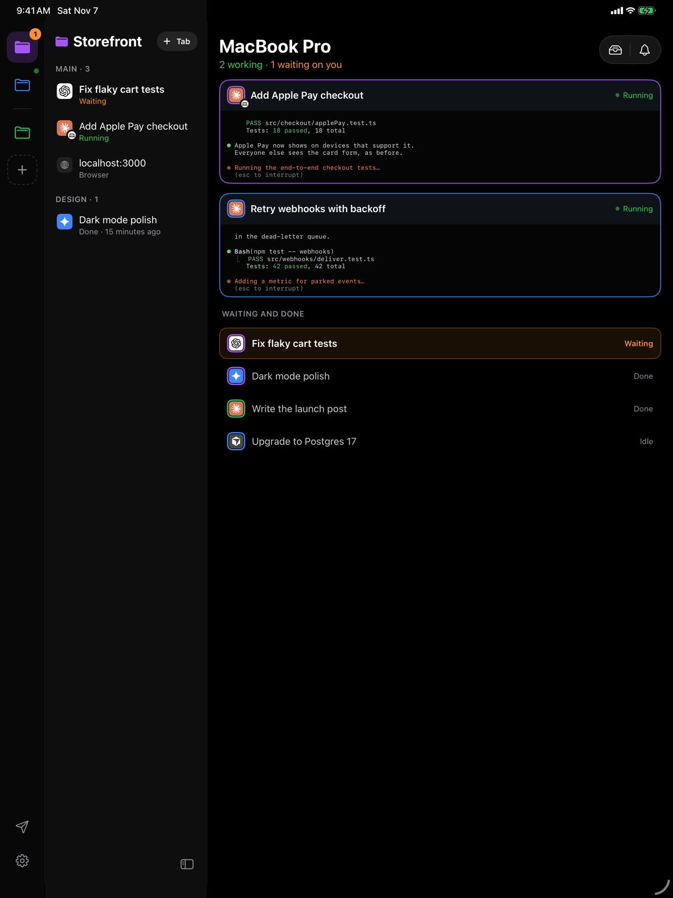
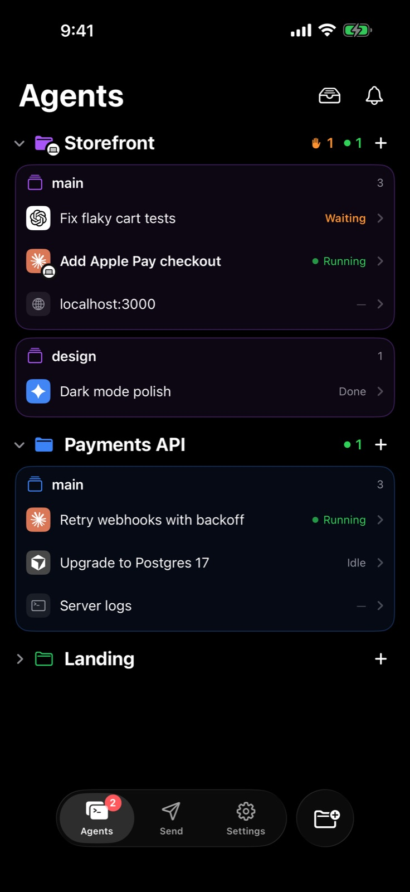

**Dax Companion** est l'application mobile de Dax. Lancez une tâche à votre
bureau, éloignez-vous et gardez-la en mouvement depuis votre iPhone ou votre
iPad : chaque agent de votre Mac, ce qu'il fait, ce qu'il a terminé et ce
qu'il attend de vous.

<Card title="Télécharger sur l'App Store" icon="apple" href="https://apps.apple.com/app/dax-companion/id6828041761" horizontal>
  Gratuit, pour iPhone et iPad. Nécessite Dax sur votre Mac.
</Card>

<Frame>
  
</Frame>

## Associez-le à votre Mac

<Steps>
  <Step title="Installez l'application">
    Récupérez [Dax Companion sur l'App Store](https://apps.apple.com/app/dax-companion/id6828041761)
    sur votre iPhone ou iPad.
  </Step>
  <Step title="Affichez le code sur votre Mac">
    Dans Dax, cliquez sur le téléphone en bas de la barre latérale, puis sur
    **Add a device**. Un code QR apparaît.
  </Step>
  <Step title="Scannez-le">
    Ouvrez Dax Companion et scannez le code. C'est tout : aucun compte à créer
    sur le téléphone. Associez autant d'iPhone et d'iPad que vous voulez.
  </Step>
</Steps>

## Ce que vous pouvez faire

<CardGroup cols={2}>
  <Card title="Voir chaque agent" icon="layer-group">
    Chaque agent de chaque projet, en cours, en attente, inactif ou terminé, en
    direct à mesure que les choses changent. Claude Code, Codex, Gemini CLI,
    Cursor et d'autres agents de terminal.
  </Card>
  <Card title="Pilotez de n'importe où" icon="terminal">
    Regardez le terminal d'un agent pendant qu'il travaille, saisissez son
    prochain prompt ou répondez à sa question. Cela part directement vers
    l'agent sur votre Mac.
  </Card>
  <Card title="Ne manquez aucune question" icon="bell">
    Une notification dès qu'un agent termine ou a besoin de vous ; répondez
    d'une simple pression. Sur iPhone, suivez une tâche sur l'écran verrouillé
    et dans la Dynamic Island.
  </Card>
  <Card title="Envoyer vers votre Mac" icon="paper-plane">
    Photos, vidéos, fichiers et liens vers le File Drawer de votre Mac, son
    presse-papiers ou directement vers un agent, depuis l'application ou la
    feuille de partage.
  </Card>
  <Card title="Votre Mac, à portée de main" icon="laptop">
    Batterie, volume, luminosité et commandes multimédias. Verrouillez-le,
    gardez-le éveillé ou jetez un œil à son écran quand vous activez le
    partage d'écran.
  </Card>
  <Card title="Clips AI Video" icon="film">
    Les clips que vous créez avec AI Video de Dax arrivent tout seuls sur votre
    iPhone et votre iPad, prêts à être enregistrés dans Photos.
  </Card>
</CardGroup>

## Sur iPad

L'iPad dispose d'une mise en page à lui : vos projets dans une colonne, leurs
agents à côté et le terminal à droite. Quand rien n'est ouvert, chaque agent en
cours apparaît comme une carte de terminal en direct, ce qui permet de
surveiller tout le troupeau d'un coup d'œil. Tournez-le sur la tranche et la
page Mac affiche côte à côte l'écran de votre Mac et ses commandes.

<Frame>
  
</Frame>

## Dissocier

Sur le téléphone, **Settings › Unpair this iPhone** (ou iPad). Sur le Mac,
cliquez sur le téléphone en bas de la barre latérale et choisissez
**Disconnect** pour l'appareil. L'un ou l'autre le coupe immédiatement.
