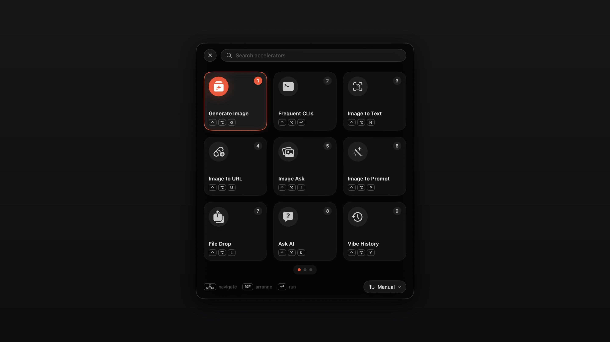

Dax est une seule plateforme. La **fenetre principale** est l'endroit ou
tournent vos agents de code. Les **Accelerators** sont les parties de Dax
que vous invoquez depuis n'importe quelle app. **Dax Companion** met le tout
sur votre iPhone et votre iPad. Certaines choses sont vraies partout, alors
autant les expliquer une seule fois ici.

## Invoquer les Accelerators

- **Chaque Accelerator a un raccourci global.** Par defaut, ce sont tous
  <kbd>⌃</kbd> <kbd>⌥</kbd> plus une touche. Reassignez ou effacez
  n'importe quel raccourci dans **Settings -> Shortcuts** (<kbd>⌃</kbd>
  <kbd>⌥</kbd> <kbd>H</kbd>). Voir la [reference
  rapide](/fr/shortcuts) pour la liste complete.
- **Le lanceur d'Accelerators :** appuyez sur <kbd>⌃</kbd> <kbd>⌥</kbd>
  <kbd>Space</kbd> pour ouvrir une grille listant tous les Accelerators.
  Cliquez sur l'un d'eux, ou appuyez sur <kbd>1</kbd>-<kbd>9</kbd> pour les
  neuf premiers. Pratique tant que vous ne connaissez pas encore un
  raccourci par coeur.
- **L'icone de la barre de menu** les liste aussi, et ouvre Settings.

<Frame>
  
</Frame>

### Raccourcis de Dax

| Raccourci | Ouvre |
| --- | --- |
| <kbd>⌃</kbd> <kbd>⌥</kbd> <kbd>Space</kbd> | Le lanceur d'Accelerators |
| <kbd>⌃</kbd> <kbd>⌥</kbd> <kbd>,</kbd> | Settings |
| <kbd>⌃</kbd> <kbd>⌥</kbd> <kbd>T</kbd> | Settings -> Accelerators |
| <kbd>⌃</kbd> <kbd>⌥</kbd> <kbd>H</kbd> | Settings -> Shortcuts (reassigner les raccourcis) |

## Premiers pas

Au premier lancement de Dax, un ecran de configuration vous guide a travers
la creation d'un compte :

- **Inscrivez-vous** avec votre nom et votre e-mail. Nous vous envoyons un
  code ; saisissez-le et votre compte s'active instantanement. Commencez
  avec le plan **Free** et passez au plan **Pro** (10 $/mois, 2 500 credits)
  via Stripe a tout moment.

Vous avez deja un code ? Il y a un lien **Already have a code?** sur
l'ecran de configuration pour le saisir directement.

Une fois active, votre jeton d'acces personnel est stocke dans le Trousseau
de votre Mac et tout Dax se debloque.

### Plans (comptes geres)

Chaque plan donne acces a tout Dax. Seule l'IA utilise des credits.

| | Free | Pro (10 $/mois) |
| --- | --- | --- |
| Credits IA | Une image offerte, une fois | 2 500 par mois |
| Ask AI | Avec une recharge | Inclus, avec Deep Research et Web Search |
| AI Video | — | Inclus |
| Envoi de fichiers | 64 Mo par fichier | 10 Go |
| Agents, serveurs SSH, Accelerators | Inclus | Inclus |

Le credit offert de Free suffit pour une image generee et ne se renouvelle
pas. Pour utiliser Ask AI en Free, achetez une recharge.

#### Cout des credits

| Action | Credits |
| --- | --- |
| Ask AI | 1 |
| Reecrire un texte | 1 |
| Web Search (Ask AI) | 2 |
| Question sur une image | 2 |
| Remplir un formulaire depuis le contexte | 2 |
| AI prompt | 2 |
| Rediger une specification | 5 |
| Generate Image | 25 |
| Deep Research | 25 |
| AI Video | Par clip, selon le modele et la duree |

Les credits Pro se reinitialisent le 1er de chaque mois.

#### Recharger des credits

Besoin de plus de credits ? Achetez une recharge dans Dax a tout moment. Les
credits sont ajoutes aussitot. En Pro ils restent valables jusqu'a la fin du
mois ; en Free ils restent jusqu'a ce que vous les utilisiez.

| Prix | Credits |
| --- | --- |
| 10 $ | 2 500 |
| 20 $ | 5 200 |
| 50 $ | 13 500 |
| 100 $ | 28 000 |
| 250 $ | 72 500 |

Ordre de depense : les credits du plan d'abord, puis ceux des recharges.

Passez au plan superieur a tout moment depuis la fenetre **Usage**. Gerez
ou annulez votre abonnement via le portail client Stripe.

Si votre compte est suspendu, Dax passe en mode verrouille et chaque
Accelerator vous redirige poliment vers le support plutot que de s'ouvrir.

## Accelerators en ligne et hors ligne

Certains Accelerators sont entierement locaux ; d'autres ont besoin
d'internet. **Hors ligne, les Accelerators qui necessitent le reseau
s'estompent dans le lanceur** et affichent un message « necessite internet »
plutot que d'ouvrir un panneau voue a echouer. Ils se reactivent des que la
connexion revient.

<CardGroup cols={2}>
  <Card title="Fonctionnent hors ligne" icon="wifi-slash">
    [Fenêtre principale](/fr/main-window), [Frequent CLIs](/fr/accelerators/frequent-clis), [Inject MD or Skill](/fr/accelerators/inject-md) (sauf Share as a Link), [Vibe History](/fr/accelerators/vibe-history), [Image to Text](/fr/accelerators/image-to-text), [Secrets](/fr/accelerators/secrets), [Remove BG](/fr/accelerators/remove-bg), [Prompt Snippets](/fr/accelerators/prompt-snippets), [Markdown Viewer](/fr/accelerators/markdown-viewer), [Shelf](/fr/accelerators/shelf), [Schedules](/fr/accelerators/schedules)
  </Card>
  <Card title="Necessitent internet" icon="wifi">
    [Ask AI](/fr/accelerators/ask-ai), [AI Text Transform](/fr/accelerators/text-transform), [Image to Prompt](/fr/accelerators/image-to-prompt), [Image Ask](/fr/accelerators/image-ask), [Generate Image](/fr/accelerators/generate-image), [Context Form Fill](/fr/accelerators/context-fill), [Image to URL](/fr/accelerators/image-to-url), [File Drop](/fr/accelerators/file-drop), [Clip to Link](/fr/accelerators/clip-to-link), [Screen Markup](/fr/accelerators/screen-markup), [Feedback](/fr/accelerators/feedback)
  </Card>
</CardGroup>

## Notifications

Dax communique via des notifications toast discretes — de petites cartes
flottantes qui apparaissent et disparaissent d'elles-memes.

## Confidentialite

Les Accelerators locaux ne touchent jamais au reseau. Les Accelerators en
ligne envoient **uniquement** ce dont ils ont besoin, et **uniquement** quand
vous appuyez sur le raccourci ou cliquez sur un bouton, jamais parce que
vous avez copie quelque chose. Les details se trouvent sur la page de chaque
Accelerator et dans la politique de confidentialite.
