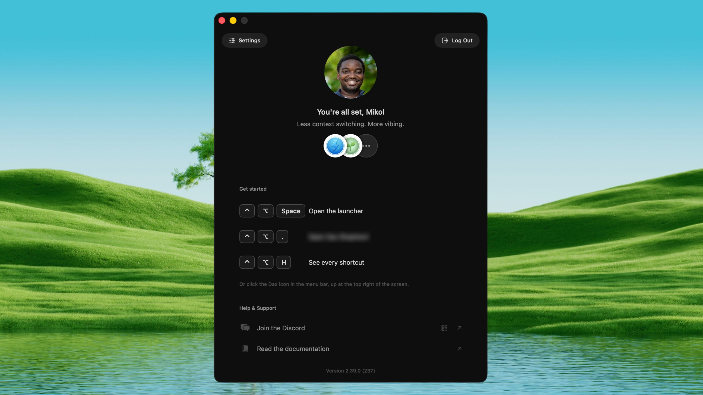

<Frame>
  
</Frame>

**The human harness for working with AI agents.** Agents have harnesses. Now you do too.

Dax est une seule plateforme pour travailler avec des agents de code IA.
Faites tourner vos agents côte à côte dans la **fenêtre principale**,
appelez un **Accelerator** depuis n'importe quelle app quand vous en avez
besoin, et suivez le tout depuis votre téléphone avec **Dax Companion**.

<CardGroup cols={3}>
  <Card title="Fenêtre principale" icon="grid-2-plus" href="/fr/main-window">
    Vos agents de code côte à côte, sur votre Mac ou sur un serveur via SSH.
  </Card>
  <Card title="Accelerators" icon="bolt" href="/fr/accelerators/overview">
    Intégrés à Dax, à un raccourci de n'importe quelle app.
  </Card>
  <Card title="Dax Companion" icon="mobile" href="/fr/companion">
    L'application mobile de Dax : vos agents de code sur iPhone et iPad.
  </Card>
</CardGroup>

## Par où commencer

<CardGroup cols={2}>
  <Card title="Démarrage rapide" icon="rocket" href="/fr/quickstart">
    Installez Dax et ouvrez votre premier Accelerator en moins de deux minutes.
  </Card>
  <Card title="Fonctionnement de Dax" icon="circle-info" href="/fr/how-dax-works">
    Votre compte, les plans et crédits, le comportement hors ligne et la
    confidentialité.
  </Card>
  <Card title="Raccourcis clavier" icon="keyboard" href="/fr/shortcuts">
    Tous les raccourcis de Dax dans un seul tableau.
  </Card>
  <Card title="Créez le vôtre" icon="code" href="/developers/accelerator-sdk">
    Écrivez un Accelerator personnalisé avec l'Accelerator SDK.
  </Card>
</CardGroup>

## Accelerators

Les Accelerators sont les parties de Dax que vous invoquez de n'importe où :
appuyez sur <kbd>⌃</kbd> <kbd>⌥</kbd> <kbd>Space</kbd> pour le lanceur, ou
sur le raccourci propre à chacun.

### Capture et partage

<CardGroup cols={3}>
  <Card title="Image to URL" icon="link" href="/fr/accelerators/image-to-url">
    Déposez une image, obtenez un lien hébergé.
  </Card>
  <Card title="File Drop" icon="files" href="/fr/accelerators/file-drop">
    Envoyez des fichiers en masse, en une seule fois.
  </Card>
  <Card title="Clip to Link" icon="video" href="/fr/accelerators/clip-to-link">
    Enregistrez une zone, obtenez un lien.
  </Card>
  <Card title="Shelf" icon="inbox" href="/fr/accelerators/shelf">
    Gardez des fichiers à portée de main au bord de votre écran.
  </Card>
  <Card title="Screen Markup" icon="pen" href="/fr/accelerators/screen-markup">
    Dessinez sur votre écran et partagez la capture.
  </Card>
</CardGroup>

### IA

<CardGroup cols={3}>
  <Card title="Ask AI" icon="comment-dots" href="/fr/accelerators/ask-ai">
    Posez une question rapide, où que vous soyez.
  </Card>
  <Card title="Image Ask" icon="comments" href="/fr/accelerators/image-ask">
    Interrogez l'IA à propos d'une image.
  </Card>
  <Card title="Generate Image" icon="image" href="/fr/accelerators/generate-image">
    Créez une image à partir d'un prompt.
  </Card>
  <Card title="Image to Prompt" icon="wand-magic-sparkles" href="/fr/accelerators/image-to-prompt">
    Transformez n'importe quelle image en prompt.
  </Card>
  <Card title="AI Text Transform" icon="pen-nib" href="/fr/accelerators/text-transform">
    Réécrivez ou retravaillez le texte sélectionné.
  </Card>
  <Card title="Context Form Fill" icon="file-lines" href="/fr/accelerators/context-fill">
    Remplissez automatiquement les formulaires avec votre contexte enregistré.
  </Card>
  <Card title="Image to Text" icon="scanner" href="/fr/accelerators/image-to-text">
    Extrayez le texte de n'importe quelle image avec l'OCR sur l'appareil.
  </Card>
</CardGroup>

### Workflow des agents

<CardGroup cols={3}>
  <Card title="Frequent CLIs" icon="terminal" href="/fr/accelerators/frequent-clis">
    Accédez directement aux CLI que vous utilisez le plus.
  </Card>
  <Card title="Inject MD or Skill" icon="markdown" href="/fr/accelerators/inject-md">
    Ajoutez un AGENTS.md ou installez une compétence dans n'importe quel projet.
  </Card>
  <Card title="Prompt Snippets" icon="note-sticky" href="/fr/accelerators/prompt-snippets">
    Des prompts enregistrés que vous pouvez rechercher et coller.
  </Card>
  <Card title="Vibe History" icon="clock-rotate-left" href="/fr/accelerators/vibe-history">
    Reprenez une session de code ou copiez son contexte dans une nouvelle.
  </Card>
  <Card title="Secrets" icon="key" href="/fr/accelerators/secrets">
    Un coffre-fort chiffré clé-valeur dans votre barre de menu.
  </Card>
  <Card title="Schedules" icon="calendar-clock" href="/fr/accelerators/schedules">
    Lancez un agent sur une tâche plus tard, ou de façon récurrente.
  </Card>
  <Card title="Markdown Viewer" icon="file-text" href="/fr/accelerators/markdown-viewer">
    Ouvrez, lisez et éditez du Markdown avec rendu en direct.
  </Card>
  <Card title="Remove BG" icon="scissors" href="/fr/accelerators/remove-bg">
    Détourez le sujet d'une image.
  </Card>
  <Card title="Feedback" icon="message-heart" href="/fr/accelerators/feedback">
    Envoyez un message et des captures d'écran à l'équipe.
  </Card>
</CardGroup>
