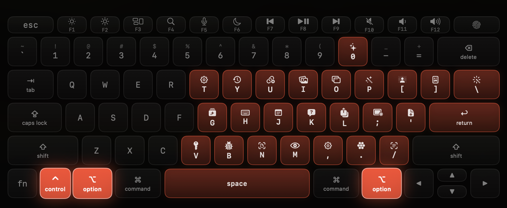

Chaque Accelerator a son propre raccourci global, et Dax en a quelques
autres pour lui-même (le lanceur, Settings, le Shelf). Tous les raccourcis
ci-dessous sont les valeurs par défaut. Réassignez ou effacez le raccourci
de n'importe quel Accelerator dans **Settings → Shortcuts** (<kbd>⌃</kbd>
<kbd>⌥</kbd> <kbd>H</kbd>), donc les vôtres peuvent différer.

<Frame>
  
</Frame>

<Note>
  Nouveau sur Dax ? [Fonctionnement de Dax](/fr/how-dax-works) couvre votre
  compte, le lanceur et le comportement hors ligne.
</Note>

## Accelerators

| Accelerator | Raccourci | Internet | En bref |
| --- | --- | :---: | --- |
| [Fenêtre principale](/fr/main-window) | <kbd>⌃</kbd> <kbd>⌥</kbd> <kbd>.</kbd> | - | Vos agents de code côte à côte, en local ou sur un serveur |
| [Frequent CLIs](/fr/accelerators/frequent-clis) | <kbd>⌃</kbd> <kbd>⌥</kbd> <kbd>Return</kbd> | - | Saisit vos commandes habituelles dans l'app active |
| [Image to URL](/fr/accelerators/image-to-url) | <kbd>⌃</kbd> <kbd>⌥</kbd> <kbd>U</kbd> | ✓ | Transforme une image copiée en lien partageable |
| [Image Ask](/fr/accelerators/image-ask) | <kbd>⌃</kbd> <kbd>⌥</kbd> <kbd>I</kbd> | ✓ | Pose une question sur une zone de l'écran |
| [Image to Prompt](/fr/accelerators/image-to-prompt) | <kbd>⌃</kbd> <kbd>⌥</kbd> <kbd>P</kbd> | ✓ | Fait remonter un prompt de génération à partir d'une image |
| [Generate Image](/fr/accelerators/generate-image) | <kbd>⌃</kbd> <kbd>⌥</kbd> <kbd>G</kbd> | ✓ | Crée ou modifie une image à partir d'un prompt |
| [AI Text Transform](/fr/accelerators/text-transform) | <kbd>⌃</kbd> <kbd>⌥</kbd> <kbd>\\</kbd> | ✓ | Réécrit le texte sélectionné sur place |
| [File Drop](/fr/accelerators/file-drop) | <kbd>⌃</kbd> <kbd>⌥</kbd> <kbd>L</kbd> | ✓ | Déposez des fichiers ou dossiers, obtenez un lien partageable |
| [Ask AI](/fr/accelerators/ask-ai) | <kbd>⌃</kbd> <kbd>⌥</kbd> <kbd>K</kbd> | ✓ | Une fenêtre flottante pour des questions rapides |
| [Vibe History](/fr/accelerators/vibe-history) | <kbd>⌃</kbd> <kbd>⌥</kbd> <kbd>Y</kbd> | - | Reprend une conversation récente Claude Code / Codex |
| [Inject MD or Skill](/fr/accelerators/inject-md) | <kbd>⌃</kbd> <kbd>⌥</kbd> <kbd>'</kbd> | ◐ | Ajoute un AGENTS.md, installe une compétence ou partage un fichier via un lien |
| [Secrets](/fr/accelerators/secrets) | <kbd>⌃</kbd> <kbd>⌥</kbd> <kbd>V</kbd> | - | Transmet des secrets aux agents de code sans les coller |
| [Context Form Fill](/fr/accelerators/context-fill) | <kbd>⌃</kbd> <kbd>⌥</kbd> <kbd>/</kbd> | ✓ | Capturez une question de formulaire, obtenez une réponse prête à coller |
| [Image to Text](/fr/accelerators/image-to-text) | <kbd>⌃</kbd> <kbd>⌥</kbd> <kbd>N</kbd> | - | Extrait le texte d'une capture d'écran ou d'une image |
| [Remove BG](/fr/accelerators/remove-bg) | <kbd>⌃</kbd> <kbd>⌥</kbd> <kbd>[</kbd> | - | Détoure le sujet d'une image, sur l'appareil |
| [Clip to Link](/fr/accelerators/clip-to-link) | <kbd>⌃</kbd> <kbd>⌥</kbd> <kbd>;</kbd> | ✓ | Enregistrez une zone, obtenez un lien GIF/MP4/MOV |
| [Prompt Snippets](/fr/accelerators/prompt-snippets) | <kbd>⌃</kbd> <kbd>⌥</kbd> <kbd>J</kbd> | - | Des prompts enregistrés que vous pouvez rechercher et coller |
| [Markdown Viewer](/fr/accelerators/markdown-viewer) | <kbd>⌃</kbd> <kbd>⌥</kbd> <kbd>]</kbd> | - | Ouvrez, lisez et éditez des fichiers Markdown avec rendu en direct |
| [Shelf](/fr/accelerators/shelf) | <kbd>⌃</kbd> <kbd>⌥</kbd> <kbd>D</kbd> | - | Gardez des fichiers à portée de main au bord de votre écran |
| [Screen Markup](/fr/accelerators/screen-markup) | <kbd>⌃</kbd> <kbd>⌥</kbd> <kbd>M</kbd> | ✓ | Dessinez sur votre écran et partagez la capture |
| [Schedules](/fr/accelerators/schedules) | <kbd>⌃</kbd> <kbd>⌥</kbd> <kbd>S</kbd> | - | Lancez un agent sur une tâche plus tard, ou de façon récurrente |
| [Feedback](/fr/accelerators/feedback) | <kbd>⌃</kbd> <kbd>⌥</kbd> <kbd>B</kbd> | ✓ | Envoyez un message et des captures d'écran à l'équipe |

<Note>
  <kbd>⌃</kbd> correspond à Control, <kbd>⌥</kbd> à Option, et
  <kbd>Return</kbd> à la touche Retour/Entrée. Un tiret dans la colonne
  Internet signifie que l'Accelerator fonctionne entièrement hors ligne.
</Note>

## Raccourcis de Dax

Ceux-ci sont fixes et ne peuvent pas être réassignés.

| Raccourci | Ouvre |
| --- | --- |
| <kbd>⌃</kbd> <kbd>⌥</kbd> <kbd>Space</kbd> | Le lanceur d'Accelerators : cliquez sur une tuile ou appuyez sur <kbd>1</kbd>–<kbd>9</kbd> |
| <kbd>⌃</kbd> <kbd>⌥</kbd> <kbd>,</kbd> | Settings |
| <kbd>⌃</kbd> <kbd>⌥</kbd> <kbd>T</kbd> | Settings → Accelerators (activer ou désactiver, réglages) |
| <kbd>⌃</kbd> <kbd>⌥</kbd> <kbd>H</kbd> | Settings → Shortcuts (réassigner les raccourcis) |
| <kbd>⌃</kbd> <kbd>⌥</kbd> + une flèche | Le Shelf, qui glisse depuis le bord opposé à la direction de la flèche |
| <kbd>⌃</kbd> <kbd>⌥</kbd> <kbd>W</kbd> | Garder le Mac éveillé, puis le laisser se remettre en veille |
| <kbd>⌃</kbd> <kbd>⌥</kbd> <kbd>0</kbd> | L'assistant de configuration |

## Gérer les Accelerators

Chaque Accelerator peut être :

- **Activé ou désactivé** dans Settings → Accelerators. Un Accelerator
  désactivé ne répond plus à son raccourci et est masqué du lanceur.
- **Réassigné ou effacé** dans Settings → Shortcuts (<kbd>⌃</kbd>
  <kbd>⌥</kbd> <kbd>H</kbd>).
- **Réorganisé ou épinglé** dans le lanceur : choisissez **Arrange
  Accelerators…** dans le lanceur, ou triez par plus utilisés, utilisés
  récemment, ou A–Z.

<Tip>
  Vous ne connaissez pas encore un raccourci par cœur ? Appuyez sur
  <kbd>⌃</kbd> <kbd>⌥</kbd> <kbd>Space</kbd> pour ouvrir le lanceur, où
  chaque Accelerator est à un clic (ou une touche numérique) de distance.
</Tip>
