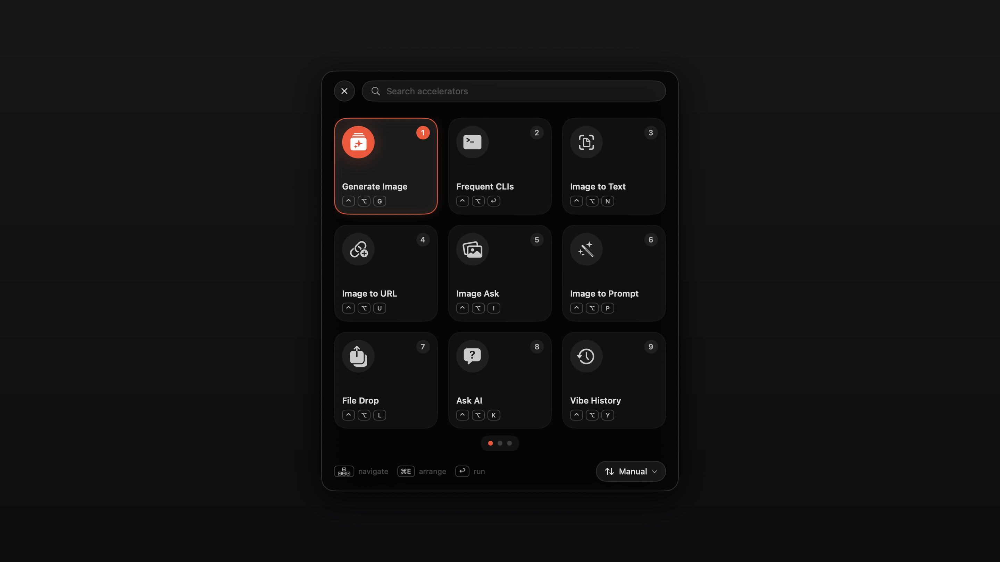

A few things are true of every tool in Dax, so they're explained once here
instead of repeating them on every tool page.

## Summoning tools

- **Every tool has a global shortcut.** By default they're all <kbd>⌃</kbd>
  <kbd>⌥</kbd> plus one key. Rebind or clear any shortcut in **Settings →
  Shortcuts** (<kbd>⌃</kbd> <kbd>⌥</kbd> <kbd>H</kbd>). See the [Quick
  reference](/shortcuts) for the full list.
- **The launcher grid:** press <kbd>⌃</kbd> <kbd>⌥</kbd> <kbd>Space</kbd> to
  open a grid of every tool. Click one, or press <kbd>1</kbd>–<kbd>9</kbd> for
  the first nine. Handy before you've memorized a shortcut.
- **The menu-bar icon** lists the tools too, and opens Settings.

<Frame>
  
</Frame>

### Global shortcuts (not tools)

| Shortcut | Opens |
| --- | --- |
| <kbd>⌃</kbd> <kbd>⌥</kbd> <kbd>Space</kbd> | The tool launcher grid |
| <kbd>⌃</kbd> <kbd>⌥</kbd> <kbd>,</kbd> | Settings |
| <kbd>⌃</kbd> <kbd>⌥</kbd> <kbd>H</kbd> | Settings → Shortcuts tab (rebind shortcuts) |

## Getting started

When you first launch Dax, a setup screen walks you through creating an
account:

- **Sign up** with your name and email. We'll send you a code; type it in
  and your account activates instantly. Start on the **Free** plan and
  upgrade to **Pro** ($10/month, 2,500 credits) via Stripe any time.

Already have a code? There's an **Already have a code?** link on the setup
screen to enter it directly.

Once activated, your personal access token is stored in your Mac's Keychain
and all of Dax unlocks.

### Plans (managed accounts)

Every plan gets all of Dax. Only the AI uses credits.

| | Free | Pro ($10/mo) |
| --- | --- | --- |
| AI credits | One free image, once | 2,500 a month |
| Ask AI | With a top-up | Included, with Deep Research and Web Search |
| AI Video | — | Included |
| File uploads | 64 MB per file | 10 GB |
| Agents, SSH servers, Accelerators | Included | Included |

Free's grant is enough for one generated image and never refills. To use
Ask AI on Free, buy a top-up.

#### Credit costs

| Action | Credits |
| --- | --- |
| Ask AI | 1 |
| Rewrite text | 1 |
| Web Search (Ask AI) | 2 |
| Ask about an image | 2 |
| Fill a form from context | 2 |
| AI prompt | 2 |
| Write a spec | 5 |
| Generate Image | 25 |
| Deep Research | 25 |
| AI Video | Per clip, by model and length |

Pro's credits reset on the 1st of each month.

#### Top up credits

Need more credits? Buy a top-up any time in Dax. Credits are added at once.
On Pro they last to the end of the month; on Free they stay until you use them.

| Price | Credits |
| --- | --- |
| $10 | 2,500 |
| $20 | 5,200 |
| $50 | 13,500 |
| $100 | 28,000 |
| $250 | 72,500 |

Spend order: plan credits are used first, then top-up credits.

Upgrade any time from the **Usage** window. Manage or cancel your subscription
through the Stripe customer portal.

If your account is suspended, Dax enters a locked-down state and every tool
politely points you at support rather than opening.

## Online vs. offline tools

Some tools are purely local; others need the internet. **Offline, the network
tools dim in the launcher** and show a "needs the internet" toast instead of
opening a panel that could only fail. They re-enable the moment the
connection returns.

<CardGroup cols={2}>
  <Card title="Work offline" icon="wifi-slash">
    [Frequent CLIs](/tools/frequent-clis), [Boilerplates](/tools/boilerplates),
    [Inject MD or Skill](/tools/inject-md) (except Share as a Link), [Open Project](/tools/open-project),
    [Vibe History](/tools/vibe-history), [Command History](/tools/command-history),
    [Image to Text](/tools/image-to-text),
    [Secrets](/tools/secrets), [Remove BG](/tools/remove-bg),
    [Agent Watch](/tools/agent-watch), [Main Window](/tools/agents),
    [Prompt Snippets](/tools/prompt-snippets), [Clipboard History](/tools/clipboard-history)
  </Card>
  <Card title="Need the internet" icon="wifi">
    [Ask AI](/tools/ask-ai), [AI Text Transform](/tools/text-transform),
    [Image to Prompt](/tools/image-to-prompt), [Image Ask](/tools/image-ask),
    [Generate Image](/tools/generate-image), [Context Form Fill](/tools/context-fill),
    [Image to URL](/tools/image-to-url), [File Drop](/tools/file-drop),
    [Clip to Link](/tools/clip-to-link), [PRD Maker](/tools/prd-maker),
    [Feedback](/tools/feedback)
  </Card>
</CardGroup>

## Notifications

Dax communicates through unobtrusive toast notifications — small floating cards that appear and dismiss themselves.

## Privacy

Local tools never touch the network. Network tools send **only** what the
tool needs, and **only** when you press the shortcut or click a button,
never because you copied something. Details are in each tool's page and in
the privacy policy.
