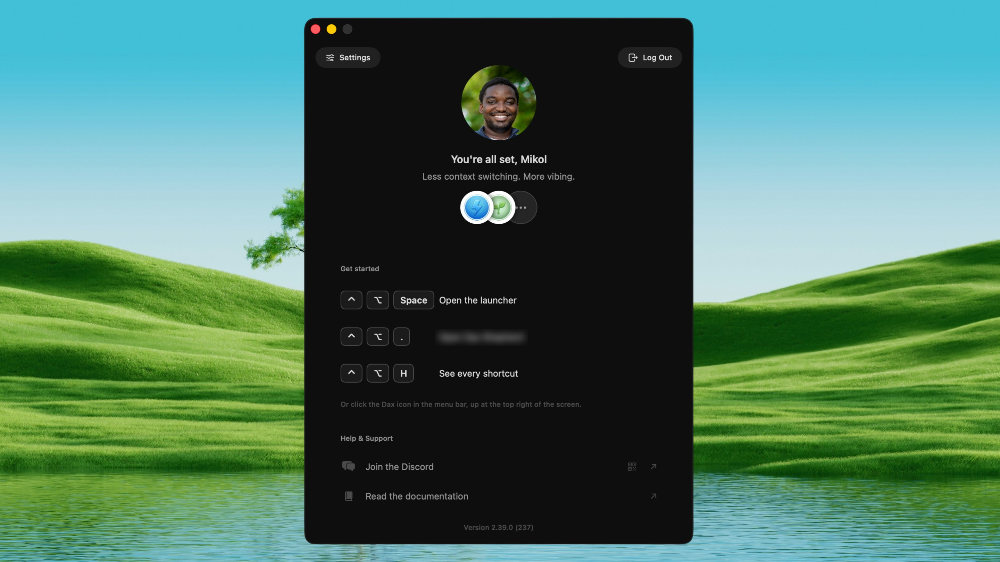

<Frame>
  
</Frame>

**The human harness for working with AI agents.** Agents have harnesses. Now you do too.

Dax is one platform for working with AI coding agents. Run your agents
side by side in the **main window**, reach for an **Accelerator** from any
app when you need one, and keep up with all of it from your phone with
**Dax Companion**.

<CardGroup cols={3}>
  <Card title="Main Window" icon="grid-2-plus" href="/main-window">
    Your coding agents side by side, on your Mac or a server over SSH.
  </Card>
  <Card title="Accelerators" icon="bolt" href="/accelerators/overview">
    Built into Dax, one shortcut away from any app.
  </Card>
  <Card title="Dax Companion" icon="mobile" href="/companion">
    The mobile app for Dax: your coding agents on iPhone and iPad.
  </Card>
</CardGroup>

## Start here

<CardGroup cols={2}>
  <Card title="Quickstart" icon="rocket" href="/quickstart">
    Install Dax and open your first Accelerator in under two minutes.
  </Card>
  <Card title="How Dax works" icon="circle-info" href="/how-dax-works">
    Your account, plans and credits, offline behavior, and privacy.
  </Card>
  <Card title="Keyboard shortcuts" icon="keyboard" href="/shortcuts">
    Every shortcut in Dax in one table.
  </Card>
  <Card title="Build your own" icon="code" href="/developers/accelerator-sdk">
    Write a custom Accelerator with the Accelerator SDK.
  </Card>
</CardGroup>

## Accelerators

Accelerators are the parts of Dax you summon from anywhere: press
<kbd>⌃</kbd> <kbd>⌥</kbd> <kbd>Space</kbd> for the launcher, or each one's own
shortcut.

### Capture & share

<CardGroup cols={3}>
  <Card title="Image to URL" icon="link" href="/accelerators/image-to-url">
    Drop an image, get a hosted link.
  </Card>
  <Card title="File Drop" icon="files" href="/accelerators/file-drop">
    Bulk-upload files in one go.
  </Card>
  <Card title="Clip to Link" icon="video" href="/accelerators/clip-to-link">
    Record a region, get a link.
  </Card>
  <Card title="Shelf" icon="inbox" href="/accelerators/shelf">
    Keep files on hand at the edge of your screen.
  </Card>
  <Card title="Screen Markup" icon="pen" href="/accelerators/screen-markup">
    Draw on your screen and share the capture.
  </Card>
</CardGroup>

### AI

<CardGroup cols={3}>
  <Card title="Ask AI" icon="comment-dots" href="/accelerators/ask-ai">
    Ask a quick question, anywhere.
  </Card>
  <Card title="Image Ask" icon="comments" href="/accelerators/image-ask">
    Ask AI about an image.
  </Card>
  <Card title="Generate Image" icon="image" href="/accelerators/generate-image">
    Make an image from a prompt.
  </Card>
  <Card title="Image to Prompt" icon="wand-magic-sparkles" href="/accelerators/image-to-prompt">
    Turn any image into a prompt.
  </Card>
  <Card title="AI Text Transform" icon="pen-nib" href="/accelerators/text-transform">
    Rewrite or reshape selected text.
  </Card>
  <Card title="Context Form Fill" icon="file-lines" href="/accelerators/context-fill">
    Auto-fill forms using your saved context.
  </Card>
  <Card title="Image to Text" icon="scanner" href="/accelerators/image-to-text">
    Pull text from any image with on-device OCR.
  </Card>
</CardGroup>

### Agent workflow

<CardGroup cols={3}>
  <Card title="Frequent CLIs" icon="terminal" href="/accelerators/frequent-clis">
    Jump to the CLIs you use most.
  </Card>
  <Card title="Inject MD or Skill" icon="markdown" href="/accelerators/inject-md">
    Drop an AGENTS.md or install a skill into any project.
  </Card>
  <Card title="Prompt Snippets" icon="note-sticky" href="/accelerators/prompt-snippets">
    Saved prompts you can search and paste.
  </Card>
  <Card title="Vibe History" icon="clock-rotate-left" href="/accelerators/vibe-history">
    Resume a coding session or copy its context to a new one.
  </Card>
  <Card title="Secrets" icon="key" href="/accelerators/secrets">
    Encrypted key-value vault in your menu bar.
  </Card>
  <Card title="Schedules" icon="calendar-clock" href="/accelerators/schedules">
    Start an agent on a task later, or on a repeat.
  </Card>
  <Card title="Markdown Viewer" icon="file-text" href="/accelerators/markdown-viewer">
    Open, read, and edit Markdown with live rendering.
  </Card>
  <Card title="Remove BG" icon="scissors" href="/accelerators/remove-bg">
    Cut the subject out of a picture.
  </Card>
  <Card title="Feedback" icon="message-heart" href="/accelerators/feedback">
    Send a note and screen snips to the team.
  </Card>
</CardGroup>
