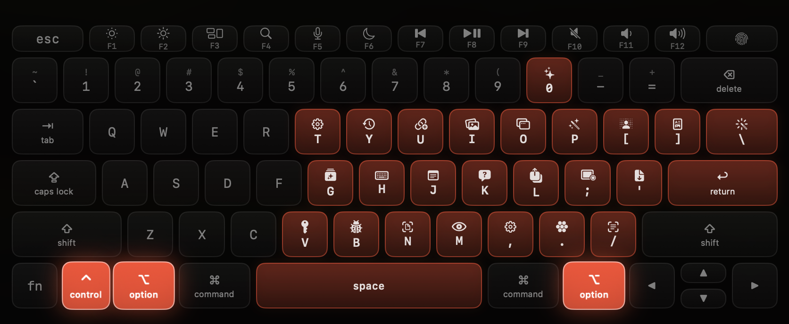

Every Accelerator has its own global shortcut, and Dax has a handful more
for itself (the launcher, Settings, the Shelf). All shortcuts below are the
defaults. Rebind or clear any Accelerator's shortcut in **Settings →
Shortcuts** (<kbd>⌃</kbd> <kbd>⌥</kbd> <kbd>H</kbd>), so yours may differ.

<Frame>
  
</Frame>

<Note>
  New to Dax? [How Dax works](/how-dax-works) covers your account, the
  launcher, and offline behavior.
</Note>

## Accelerators

| Accelerator | Shortcut | Internet | One-liner |
| --- | --- | :---: | --- |
| [Main Window](/main-window) | <kbd>⌃</kbd> <kbd>⌥</kbd> <kbd>.</kbd> | - | Your coding agents side by side, locally or on a server |
| [Frequent CLIs](/accelerators/frequent-clis) | <kbd>⌃</kbd> <kbd>⌥</kbd> <kbd>Return</kbd> | - | Type your go-to commands into the focused app |
| [Image to URL](/accelerators/image-to-url) | <kbd>⌃</kbd> <kbd>⌥</kbd> <kbd>U</kbd> | ✓ | Turn a copied image into a shareable link |
| [Image Ask](/accelerators/image-ask) | <kbd>⌃</kbd> <kbd>⌥</kbd> <kbd>I</kbd> | ✓ | Ask a question about a screen region |
| [Image to Prompt](/accelerators/image-to-prompt) | <kbd>⌃</kbd> <kbd>⌥</kbd> <kbd>P</kbd> | ✓ | Reverse-engineer an image into a generation prompt |
| [Generate Image](/accelerators/generate-image) | <kbd>⌃</kbd> <kbd>⌥</kbd> <kbd>G</kbd> | ✓ | Create or edit an image from a prompt |
| [AI Text Transform](/accelerators/text-transform) | <kbd>⌃</kbd> <kbd>⌥</kbd> <kbd>\\</kbd> | ✓ | Rewrite selected text in place |
| [File Drop](/accelerators/file-drop) | <kbd>⌃</kbd> <kbd>⌥</kbd> <kbd>L</kbd> | ✓ | Drop files/folders, get one shareable link |
| [Ask AI](/accelerators/ask-ai) | <kbd>⌃</kbd> <kbd>⌥</kbd> <kbd>K</kbd> | ✓ | A floating prompt box for quick questions |
| [Vibe History](/accelerators/vibe-history) | <kbd>⌃</kbd> <kbd>⌥</kbd> <kbd>Y</kbd> | - | Resume a recent Claude Code / Codex chat |
| [Inject MD or Skill](/accelerators/inject-md) | <kbd>⌃</kbd> <kbd>⌥</kbd> <kbd>'</kbd> | ◐ | Drop AGENTS.md, install a skill, or share a file as a link |
| [Secrets](/accelerators/secrets) | <kbd>⌃</kbd> <kbd>⌥</kbd> <kbd>V</kbd> | - | Hand secrets to coding agents without pasting them |
| [Context Form Fill](/accelerators/context-fill) | <kbd>⌃</kbd> <kbd>⌥</kbd> <kbd>/</kbd> | ✓ | Snip a form question, get a paste-ready answer |
| [Image to Text](/accelerators/image-to-text) | <kbd>⌃</kbd> <kbd>⌥</kbd> <kbd>N</kbd> | - | Extract text from a screenshot or image |
| [Remove BG](/accelerators/remove-bg) | <kbd>⌃</kbd> <kbd>⌥</kbd> <kbd>[</kbd> | - | Cut the subject out of a picture, on-device |
| [Clip to Link](/accelerators/clip-to-link) | <kbd>⌃</kbd> <kbd>⌥</kbd> <kbd>;</kbd> | ✓ | Record a region, get a GIF/MP4/MOV link |
| [Prompt Snippets](/accelerators/prompt-snippets) | <kbd>⌃</kbd> <kbd>⌥</kbd> <kbd>J</kbd> | - | Saved prompts you can search and paste |
| [Markdown Viewer](/accelerators/markdown-viewer) | <kbd>⌃</kbd> <kbd>⌥</kbd> <kbd>]</kbd> | - | Open, read, and edit Markdown files with live rendering |
| [Shelf](/accelerators/shelf) | <kbd>⌃</kbd> <kbd>⌥</kbd> <kbd>D</kbd> | - | Keep files on hand at the edge of your screen |
| [Screen Markup](/accelerators/screen-markup) | <kbd>⌃</kbd> <kbd>⌥</kbd> <kbd>M</kbd> | ✓ | Draw on your screen and share the capture |
| [Schedules](/accelerators/schedules) | <kbd>⌃</kbd> <kbd>⌥</kbd> <kbd>S</kbd> | - | Start an agent on a task later, or on a repeat |
| [Feedback](/accelerators/feedback) | <kbd>⌃</kbd> <kbd>⌥</kbd> <kbd>B</kbd> | ✓ | Send a note and screen snips to the team |

<Note>
  <kbd>⌃</kbd> is Control, <kbd>⌥</kbd> is Option, and <kbd>Return</kbd> is the Return/Enter key.
  A dash in the Internet column means the Accelerator works fully offline.
</Note>

## Dax shortcuts

These are fixed and can't be rebound.

| Shortcut | Opens |
| --- | --- |
| <kbd>⌃</kbd> <kbd>⌥</kbd> <kbd>Space</kbd> | The Accelerator launcher: click a tile or press <kbd>1</kbd>–<kbd>9</kbd> |
| <kbd>⌃</kbd> <kbd>⌥</kbd> <kbd>,</kbd> | Settings |
| <kbd>⌃</kbd> <kbd>⌥</kbd> <kbd>T</kbd> | Settings → Accelerators (switch on or off, settings) |
| <kbd>⌃</kbd> <kbd>⌥</kbd> <kbd>H</kbd> | Settings → Shortcuts (rebind shortcuts) |
| <kbd>⌃</kbd> <kbd>⌥</kbd> + an arrow | The Shelf, sliding in from the edge the arrow points away from |
| <kbd>⌃</kbd> <kbd>⌥</kbd> <kbd>W</kbd> | Keep the Mac awake, and let it sleep again |
| <kbd>⌃</kbd> <kbd>⌥</kbd> <kbd>0</kbd> | The setup assistant |

## Managing Accelerators

Every Accelerator can be:

- **Switched on or off** in Settings → Accelerators. An Accelerator that's
  off doesn't respond to its shortcut and is hidden from the launcher.
- **Rebound or cleared** in Settings → Shortcuts (<kbd>⌃</kbd> <kbd>⌥</kbd>
  <kbd>H</kbd>).
- **Reordered or pinned** in the launcher: choose **Arrange Accelerators…**
  in the launcher, or sort by most used, recently used, or A–Z.

<Tip>
  Don't have a shortcut memorized yet? Press <kbd>⌃</kbd> <kbd>⌥</kbd>
  <kbd>Space</kbd> for the launcher, where every Accelerator is one click (or
  one number key) away.
</Tip>
