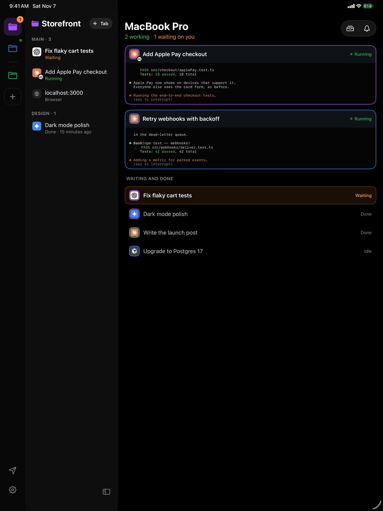
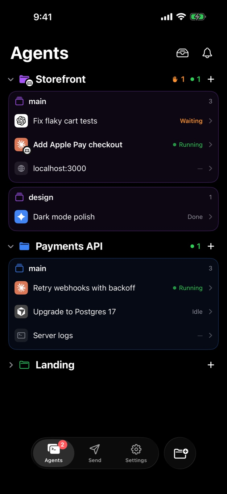

**Dax Companion** 是 Dax 的移动应用。在桌前启动任务，起身离开后，仍可用 iPhone 或 iPad 让它继续推进：你 Mac 上的每个 Agent、它正在做什么、已经完成了什么，以及它在等你处理什么。

<Card title="在 App Store 下载" icon="apple" href="https://apps.apple.com/app/dax-companion/id6828041761" horizontal>
  免费，支持 iPhone 和 iPad。需要在 Mac 上运行 Dax。
</Card>

<Frame>
  
</Frame>

## 与 Mac 配对

<Steps>
  <Step title="安装应用">
    在你的 iPhone 或 iPad 上从 App Store 获取 [Dax Companion](https://apps.apple.com/app/dax-companion/id6828041761)。
  </Step>
  <Step title="在 Mac 上显示二维码">
    在 Dax 中，点击侧边栏底部的手机图标，然后选择 **Add a device**。
    屏幕上会出现一个二维码。
  </Step>
  <Step title="扫描二维码">
    打开 Dax Companion 并扫描该二维码。就这么简单：无需在手机上创建账号。
    你可以配对任意数量的 iPhone 和 iPad。
  </Step>
</Steps>

## 你可以做什么

<CardGroup cols={2}>
  <Card title="查看每个 Agent" icon="layer-group">
    每个项目中的每个 Agent，无论是运行中、等待中、空闲还是已完成，状态变化实时呈现。
    支持 Claude Code、Codex、Gemini CLI、Cursor 以及其他终端 Agent。
  </Card>
  <Card title="随时随地掌舵" icon="terminal">
    观看 Agent 工作时的终端，输入它的下一条提示词，或回答它的提问。
    内容会直接送达你 Mac 上的 Agent。
  </Card>
  <Card title="不错过任何提问" icon="bell">
    Agent 一完成或需要你时，立刻推送通知；轻点一下即可回应。
    在 iPhone 上，还可以在锁屏和灵动岛中跟踪任务。
  </Card>
  <Card title="发送到 Mac" icon="paper-plane">
    从应用或共享菜单，把照片、视频、文件和链接发送到 Mac 的 Shelf、剪贴板，
    或直接发给某个 Agent。
  </Card>
  <Card title="Mac 尽在掌握" icon="laptop">
    电池、音量、亮度和媒体控制。可以锁定 Mac、让它保持唤醒，
    开启屏幕共享后还能查看它的屏幕。
  </Card>
  <Card title="AI Video 片段" icon="film">
    你用 Dax 的 AI Video 制作的片段会自动出现在 iPhone 和 iPad 上，随时可保存到“照片”。
  </Card>
</CardGroup>

## 在 iPad 上

iPad 拥有专属布局：项目显示在侧栏，它们的 Agent 紧挨其旁，终端位于右侧。
未打开任何内容时，每个运行中的 Agent 都会以实时终端卡片显示，让你一眼看清整个 Agent 群。
将 iPad 横过来，“Mac”页面会把 Mac 的屏幕和控制项并排显示。

<Frame>
  
</Frame>

## 取消配对

在手机上，选择 **Settings › Unpair this iPhone**（iPad 上同理）。在 Mac 上，点击侧边栏底部的手机图标，
然后为该设备选择 **Disconnect**。任一方式都会立即切断连接。
