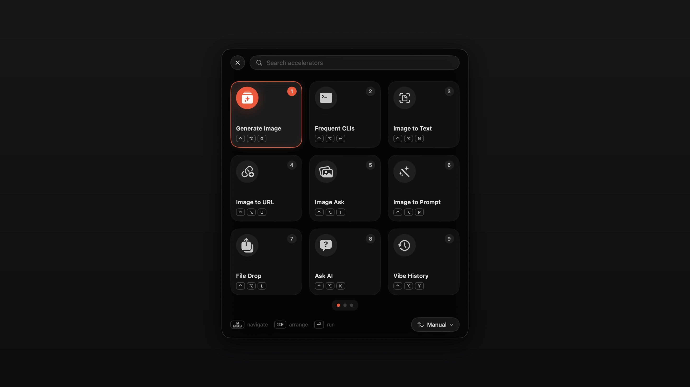

Dax 里的每个工具都遵循一些共同的规则，与其在每个工具页面里各讲一遍，不如
在这里统一说明。

## 呼出工具

- **每个工具都有一个全局快捷键。** 默认都是 <kbd>⌃</kbd> <kbd>⌥</kbd> 加一个
  按键。在 **设置 → Shortcuts**（<kbd>⌃</kbd> <kbd>⌥</kbd> <kbd>H</kbd>）里
  可以重新绑定或清除任意快捷键，完整列表见[快速参考](/zh/shortcuts)。
- **启动器网格**：按下 <kbd>⌃</kbd> <kbd>⌥</kbd> <kbd>Space</kbd> 打开包含
  所有工具的网格。点击一个，或按 <kbd>1</kbd>–<kbd>9</kbd> 选择前九个。在你
  还没记住快捷键之前很好用。
- **菜单栏图标**同样列出所有工具，也能打开设置。

<Frame>
  
</Frame>

### 全局快捷键（非工具）

| 快捷键 | 打开 |
| --- | --- |
| <kbd>⌃</kbd> <kbd>⌥</kbd> <kbd>Space</kbd> | 工具启动器网格 |
| <kbd>⌃</kbd> <kbd>⌥</kbd> <kbd>,</kbd> | 设置 |
| <kbd>⌃</kbd> <kbd>⌥</kbd> <kbd>H</kbd> | 设置 → Shortcuts 标签（重新绑定快捷键） |

## 入门

首次启动 Dax 时，设置界面会引导你创建账号：

- **注册**时输入你的姓名和邮箱。我们会发送一个验证码，输入后你的账号立即激活。
  初始为 **Free** 方案，可随时通过 Stripe 升级到 **Pro**（$10/月，2,500 credits）。

已有验证码？设置界面上有一个 **Already have a code?** 链接，可直接输入。

激活后，你的个人访问令牌会存储在 Mac 的钥匙串中，整个 Dax 随即解锁。

### 方案（托管账号）

每个方案都包含完整的 Dax。只有 AI 功能消耗 credits。

| | Free | Pro ($10/月) |
| --- | --- | --- |
| AI credits | 免费一张图片，仅一次 | 每月 2,500 |
| Ask AI | 需购买充值包 | 包含，含 Deep Research 和 Web Search |
| AI Video | — | 包含 |
| 文件上传 | 每个文件 64 MB | 10 GB |
| 智能体、SSH 服务器、Accelerators | 包含 | 包含 |

Free 的赠送额度足够生成一张图片，且不会重置。在 Free 上使用 Ask AI 需要购买充值包。

#### Credit 消耗

| 操作 | Credits |
| --- | --- |
| Ask AI | 1 |
| 改写文本 | 1 |
| Web Search (Ask AI) | 2 |
| 询问图片 | 2 |
| 根据上下文填写表单 | 2 |
| AI prompt | 2 |
| 撰写规格文档 | 5 |
| Generate Image | 25 |
| Deep Research | 25 |
| AI Video | 按片段计费，取决于模型和时长 |

Pro 的 credits 在每月 1 日重置。

#### 充值 credits

需要更多 credits？随时在 Dax 中购买充值包，credits 即时到账。Pro 上有效期到月底；Free 上一直保留到用完。

| 价格 | Credits |
| --- | --- |
| $10 | 2,500 |
| $20 | 5,200 |
| $50 | 13,500 |
| $100 | 28,000 |
| $250 | 72,500 |

消费顺序：先用方案 credits，再用充值 credits。

随时在 **Usage** 窗口中升级。通过 Stripe 客户门户管理或取消你的订阅。

如果你的账号被暂停，Dax 会进入锁定状态，所有工具都会礼貌地把你指向支持渠道，
而不是正常打开。

## 在线与离线工具

有些工具完全本地运行，有些需要联网。**离线时，需要联网的工具会在启动器里变暗**，
并显示一个「需要联网」的提示，而不是打开一个注定会失败的面板。网络恢复的瞬间
它们会重新启用。

<CardGroup cols={2}>
  <Card title="离线可用" icon="wifi-slash">
    [Frequent CLIs](/zh/tools/frequent-clis)、[Boilerplates](/zh/tools/boilerplates)、
    [Inject MD or Skill](/zh/tools/inject-md)（以链接分享除外）、[Open Project](/zh/tools/open-project)、
    [Vibe History](/zh/tools/vibe-history)、[Command History](/zh/tools/command-history)、
    [Image to Text](/zh/tools/image-to-text)、
    [Secrets](/zh/tools/secrets)、[Remove BG](/zh/tools/remove-bg)、
    [Agent Watch](/zh/tools/agent-watch)、[主窗口](/zh/tools/agents)、
    [Prompt Snippets](/zh/tools/prompt-snippets)、[Clipboard History](/zh/tools/clipboard-history)
  </Card>
  <Card title="需要联网" icon="wifi">
    [Ask AI](/zh/tools/ask-ai)、[AI Text Transform](/zh/tools/text-transform)、
    [Image to Prompt](/zh/tools/image-to-prompt)、[Image Ask](/zh/tools/image-ask)、
    [Generate Image](/zh/tools/generate-image)、[Context Form Fill](/zh/tools/context-fill)、
    [Image to URL](/zh/tools/image-to-url)、[File Drop](/zh/tools/file-drop)、
    [Clip to Link](/zh/tools/clip-to-link)、[PRD Maker](/zh/tools/prd-maker)、
    [Feedback](/zh/tools/feedback)
  </Card>
</CardGroup>

## 通知

Dax 通过不打扰的浮动通知来传递信息——小巧的悬浮卡片会自动出现并自动消失。

## 隐私

本地工具从不联网。需要联网的工具**只**发送该工具真正需要的内容，且**只**在
你按下快捷键或点击按钮时发送，绝不会因为你复制了什么就自动发送。详情见每个
工具各自的页面，以及隐私政策。
