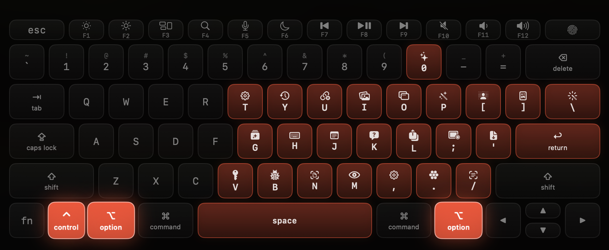

每个 Accelerator 都有专属的全局快捷键，此外 Dax 本身（启动器、设置、Shelf）也有
少数几个快捷键。以下都是默认值。你可以在 **设置 → Shortcuts**（<kbd>⌃</kbd>
<kbd>⌥</kbd> <kbd>H</kbd>）里重新绑定或清除任意 Accelerator 的快捷键，所以你的
实际设置可能有所不同。

<Frame>
  
</Frame>

<Note>
  刚接触 Dax？[Dax 如何运作](/zh/how-dax-works) 介绍了你的账号、启动器以及离线
  行为。
</Note>

## Accelerators

| Accelerator | 快捷键 | 联网 | 简介 |
| --- | --- | :---: | --- |
| [主窗口](/zh/main-window) | <kbd>⌃</kbd> <kbd>⌥</kbd> <kbd>.</kbd> | - | 并排运行你的编程 Agent，本地或在服务器上 |
| [Frequent CLIs](/zh/accelerators/frequent-clis) | <kbd>⌃</kbd> <kbd>⌥</kbd> <kbd>Return</kbd> | - | 把你常用的命令输入到当前聚焦的应用里 |
| [Image to URL](/zh/accelerators/image-to-url) | <kbd>⌃</kbd> <kbd>⌥</kbd> <kbd>U</kbd> | ✓ | 把复制的图片变成可分享的链接 |
| [Image Ask](/zh/accelerators/image-ask) | <kbd>⌃</kbd> <kbd>⌥</kbd> <kbd>I</kbd> | ✓ | 针对屏幕上的某个区域提问 |
| [Image to Prompt](/zh/accelerators/image-to-prompt) | <kbd>⌃</kbd> <kbd>⌥</kbd> <kbd>P</kbd> | ✓ | 从图片反推出一段生成提示词 |
| [Generate Image](/zh/accelerators/generate-image) | <kbd>⌃</kbd> <kbd>⌥</kbd> <kbd>G</kbd> | ✓ | 根据提示词创建或编辑一张图片 |
| [AI Text Transform](/zh/accelerators/text-transform) | <kbd>⌃</kbd> <kbd>⌥</kbd> <kbd>\\</kbd> | ✓ | 原地重写选中的文本 |
| [File Drop](/zh/accelerators/file-drop) | <kbd>⌃</kbd> <kbd>⌥</kbd> <kbd>L</kbd> | ✓ | 拖入文件或文件夹，得到一个分享链接 |
| [Ask AI](/zh/accelerators/ask-ai) | <kbd>⌃</kbd> <kbd>⌥</kbd> <kbd>K</kbd> | ✓ | 一个悬浮提问框，随时快速提问 |
| [Vibe History](/zh/accelerators/vibe-history) | <kbd>⌃</kbd> <kbd>⌥</kbd> <kbd>Y</kbd> | - | 恢复最近的 Claude Code / Codex 会话 |
| [Inject MD or Skill](/zh/accelerators/inject-md) | <kbd>⌃</kbd> <kbd>⌥</kbd> <kbd>'</kbd> | ◐ | 放入 AGENTS.md、安装技能，或以链接分享文件 |
| [Secrets](/zh/accelerators/secrets) | <kbd>⌃</kbd> <kbd>⌥</kbd> <kbd>V</kbd> | - | 无需粘贴明文即可把密钥交给编程 Agent |
| [Context Form Fill](/zh/accelerators/context-fill) | <kbd>⌃</kbd> <kbd>⌥</kbd> <kbd>/</kbd> | ✓ | 截取表单问题，获得即用答案 |
| [Image to Text](/zh/accelerators/image-to-text) | <kbd>⌃</kbd> <kbd>⌥</kbd> <kbd>N</kbd> | - | 从截图或图片中提取文字 |
| [Remove BG](/zh/accelerators/remove-bg) | <kbd>⌃</kbd> <kbd>⌥</kbd> <kbd>[</kbd> | - | 在设备上抠出图片中的主体 |
| [Clip to Link](/zh/accelerators/clip-to-link) | <kbd>⌃</kbd> <kbd>⌥</kbd> <kbd>;</kbd> | ✓ | 录制区域，获得 GIF/MP4/MOV 链接 |
| [Prompt Snippets](/zh/accelerators/prompt-snippets) | <kbd>⌃</kbd> <kbd>⌥</kbd> <kbd>J</kbd> | - | 可搜索并粘贴的已保存提示词 |
| [Markdown Viewer](/zh/accelerators/markdown-viewer) | <kbd>⌃</kbd> <kbd>⌥</kbd> <kbd>]</kbd> | - | 打开、阅读和编辑 Markdown 文件，实时渲染 |
| [Shelf](/zh/accelerators/shelf) | <kbd>⌃</kbd> <kbd>⌥</kbd> <kbd>D</kbd> | - | 把文件放在屏幕边缘，随手可取 |
| [Screen Markup](/zh/accelerators/screen-markup) | <kbd>⌃</kbd> <kbd>⌥</kbd> <kbd>M</kbd> | ✓ | 在屏幕上绘制标注，并分享截图 |
| [Schedules](/zh/accelerators/schedules) | <kbd>⌃</kbd> <kbd>⌥</kbd> <kbd>S</kbd> | - | 稍后或定期让 Agent 开始一项任务 |
| [Feedback](/zh/accelerators/feedback) | <kbd>⌃</kbd> <kbd>⌥</kbd> <kbd>B</kbd> | ✓ | 向团队发送留言和屏幕截图 |

<Note>
  <kbd>⌃</kbd> 是 Control，<kbd>⌥</kbd> 是 Option，<kbd>Return</kbd> 是 Return/Enter 键。
  「联网」一列显示为「-」表示该 Accelerator 完全离线可用。
</Note>

## Dax 快捷键

这些快捷键是固定的，无法重新绑定。

| 快捷键 | 打开 |
| --- | --- |
| <kbd>⌃</kbd> <kbd>⌥</kbd> <kbd>Space</kbd> | Accelerator 启动器：点击一个方块，或按 <kbd>1</kbd>–<kbd>9</kbd> |
| <kbd>⌃</kbd> <kbd>⌥</kbd> <kbd>,</kbd> | 设置 |
| <kbd>⌃</kbd> <kbd>⌥</kbd> <kbd>T</kbd> | 设置 → Accelerators（开启或关闭、各项设置） |
| <kbd>⌃</kbd> <kbd>⌥</kbd> <kbd>H</kbd> | 设置 → Shortcuts（重新绑定快捷键） |
| <kbd>⌃</kbd> <kbd>⌥</kbd> + 方向键 | Shelf，从与箭头方向相反的边缘滑入 |
| <kbd>⌃</kbd> <kbd>⌥</kbd> <kbd>W</kbd> | 让 Mac 保持唤醒，再按一次恢复睡眠 |
| <kbd>⌃</kbd> <kbd>⌥</kbd> <kbd>0</kbd> | 设置助手 |

## 管理 Accelerators

每个 Accelerator 都可以：

- **开启或关闭**：在 设置 → Accelerators 中操作。关闭后的 Accelerator 不再响应
  快捷键，也会从启动器中隐藏。
- **重新绑定或清除快捷键**：在 设置 → Shortcuts（<kbd>⌃</kbd> <kbd>⌥</kbd>
  <kbd>H</kbd>）中操作。
- **在启动器中重新排序或置顶**：在启动器中选择 **Arrange Accelerators…**，或按
  最常用、最近使用或 A–Z 排序。

<Tip>
  还没记住快捷键？按下 <kbd>⌃</kbd> <kbd>⌥</kbd> <kbd>Space</kbd> 打开启动器，
  每个 Accelerator 只需一次点击（或一个数字键）即可到达。
</Tip>
